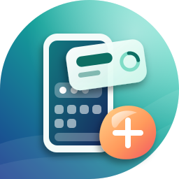
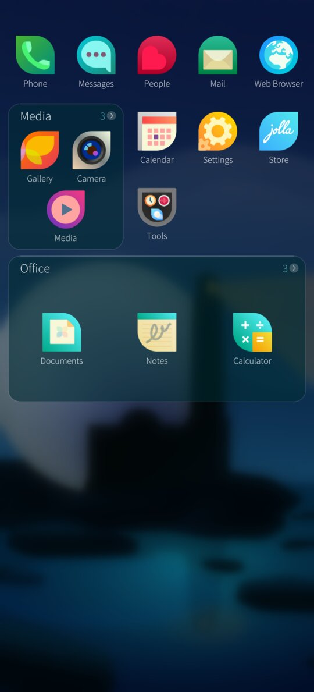
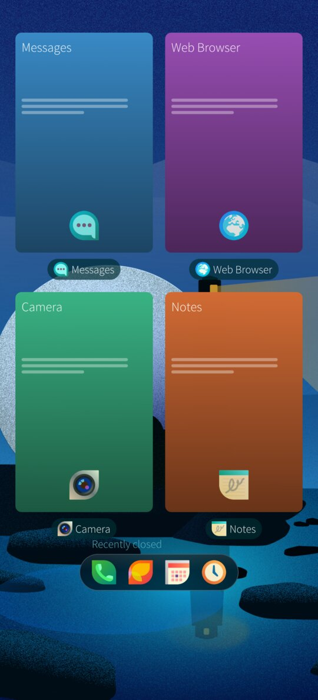
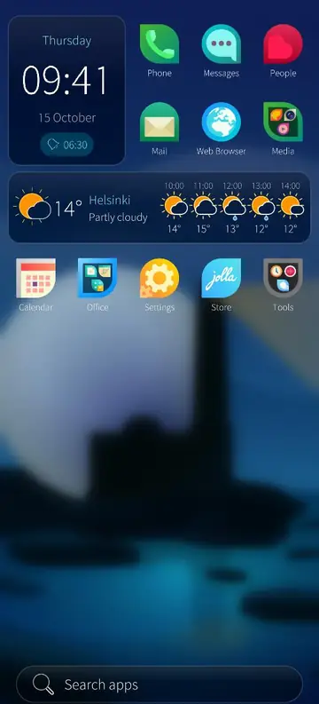
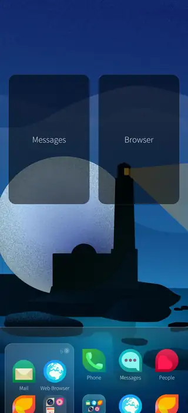
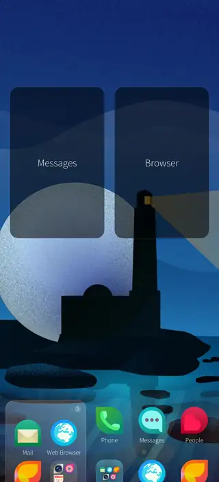
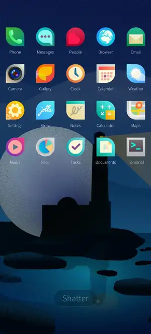
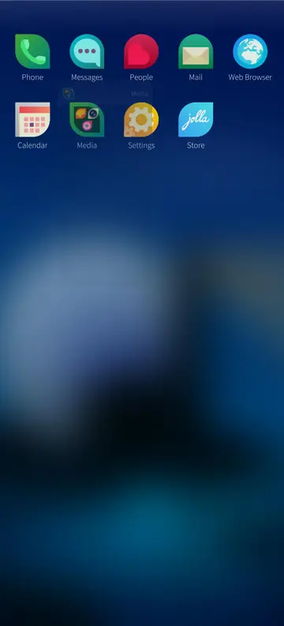
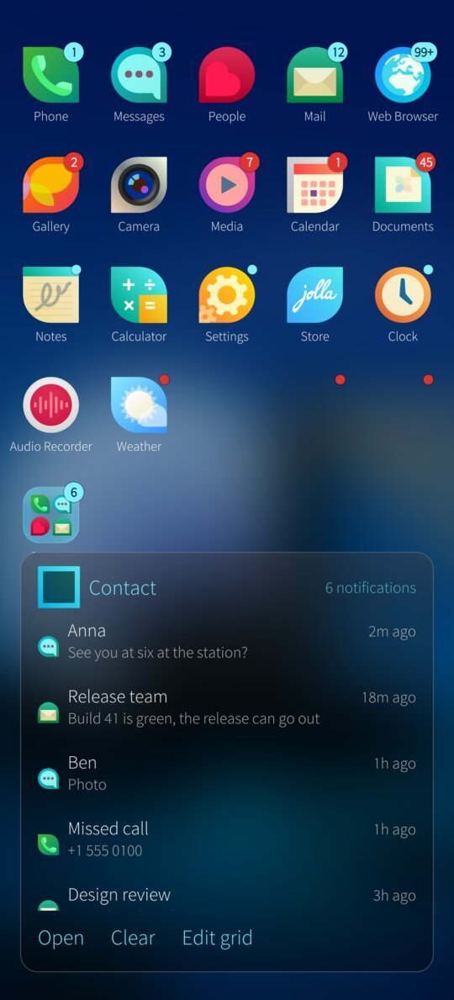
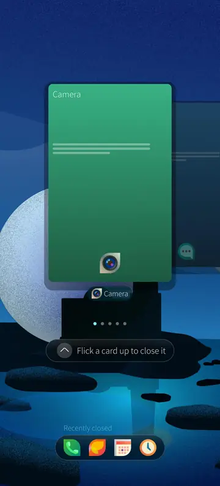

# Seaglass

Widgets, glass, app search, notification badges, a richer task switcher and app animations for the Sailfish OS home
screen.

<!-- github-only -->
[](https://github.com/Keelwing/seaglass/actions/workflows/ci.yml)
[](https://github.com/Keelwing/seaglass/releases/latest)
[](LICENSE)
[](https://keelwing.github.io/seaglass/)
[](#compatibility)
[](https://github.com/sailfishos-patches/patchmanager)
<!-- /github-only -->

Seaglass extends the stock home screen, and every part of it is a setting that can be switched off. It never changes
the home screen's files on disk: a Patchmanager patch of a few lines loads Seaglass's QML, and wherever that cannot
load, the stock home screen stays. It is free software, tested on a Jolla Phone.

<a href="https://ko-fi.com/D31m05z"></a>

<p align="center">
  
  
  
</p>

The images and animations come from the development harness, which uses only the stock apps, a stock ambience and
sample data.

<!-- github-only -->
**Contents:** [Features](#features) · [Compatibility](#compatibility) · [Install](#install) ·
[Updating and removing](#updating-and-removing) · [Privacy](#privacy) · [Troubleshooting](#troubleshooting) ·
[How it works](#how-it-works) · [Building from source](#building-from-source) · [Contributing](#contributing) ·
[Support](#support) · [License](#license)
<!-- /github-only -->

## Features

### Data widgets

Live information as glass blocks among the icons:

- a *clock*, digital or analogue, with the date and the next alarm;
- the *status*: the battery, and Wi-Fi, mobile data, Bluetooth and flight mode as chips that switch with a tap;
- *now playing*: the album art, the track, the progress and the player's buttons;
- the *next event*: the coming events in their calendars' colours, with an option to hide their details;
- the *weather*: the Weather app's place now, and the next hours or days.

A fresh install starts with the clock and the status. In the edit mode, *Add widget* opens a gallery with live
previews of each size. A widget moves like an icon, and its size pill makes it a card, a shelf or a panel. More:
[docs/WIDGETS.md](docs/WIDGETS.md).

<p align="center">
  
  
  
</p>

### Glass

The app grid rises over the home screen's wallpaper, which stays sharp under it (*Clear*, the default) or frosts like
glass as the grid comes up (*Glass*). The wallpaper eases back as the grid opens and follows the pages more slowly
than the icons; tilt and drift are optional. The picture of another ambience, or a photo, can take its place: it
rises from below and blends in as the grid opens. Folder icons, open folders and widget cards are glass too, and
*Stock* keeps the Sailfish background. More: [docs/GLASS.md](docs/GLASS.md).

<p align="center">
  
  
</p>

### App animations

Apps can open from the icon or cover you tapped, show a loading effect on their new cover while they start, and close
with the swipe from the top, in one of twelve styles: *Contour*, *Fold* and *Halftone* (drawn, folded and printed),
*Seaglass*, *Tide* and *Northern lights* (calm, made of glass, water and light), *Ember*, *Volt* and *Frost* (fire,
lightning and ice), and *Shatter*, *Singularity* and *Dust* (loud on purpose). The settings page shows every style's
opening, loading and closing at once, and plays any of them before you choose. The effects are shaders on a copy of
the window, so Sailfish never waits for them. Out of the box the animations are on with Surprise me, a different
style each time. With Surprise me off, apps open in Ember, load in Dust and close in Northern lights until you choose
others. More: [docs/ANIMATIONS.md](docs/ANIMATIONS.md).

<p align="center">
  
  
  
</p>

### Folders

- **Previews.** A folder shows small icons of its apps instead of the bare item count, in its own shape and colour.
  While an app is held over a folder, the slot where it will land pulses.
- **Folders as widgets.** A folder can open out into a glass tile on the app grid, whose apps start with one tap: a
  *card* (two by two cells), a *shelf* (the full width, one row) or a *panel* (the full width, two rows). It sits
  anywhere among the icons, which flow around it. In the edit mode it moves by dragging, changes size and takes apps
  dropped on it.
- **Motion.** A folder opens from its icon or widget and closes back into it: *zoom* (the default), *spring*,
  *reveal* or *slide*. Its apps ripple in, and the app grid steps back. The stock *fade* is there too.

More: [docs/FOLDERS.md](docs/FOLDERS.md).

<p align="center"></p>

### App search

A glass pill on the first page of the app grid holds the five apps you use most. A tap on it opens a sheet:

- before you type: the apps used most, and every app from A to Z with a letter rail;
- as you type: the matches, best first. Accents don't matter, and word starts, initials, folder names and desktop
  file names match too. *Enter* starts the first match.

More: [docs/SEARCH.md](docs/SEARCH.md).

<p align="center"></p>

### Notification badges

Apps with notifications show how many on their icons, as a count or a dot. Folders, cards and the search show them
too, and they follow the Events view live. A long press on an app or a folder with a badge shows its notifications,
to open or clear them; *Edit grid* there starts the edit mode. More: [docs/BADGES.md](docs/BADGES.md).

<p align="center"></p>

### Task switcher

- Each cover gets a chip with its app's icon and name.
- A *Recently closed* capsule starts closed apps again.
- An optional card row puts the last used app in front, and a card pulled up closes its app.
- A pinch switches between the grid and the card row, following the fingers.

More: [docs/SWITCHER.md](docs/SWITCHER.md).

<p align="center">
  
  
</p>

What changed in each version: [CHANGELOG.md](CHANGELOG.md).

## Compatibility

Seaglass patches the stock home screen of particular Sailfish OS versions, so each version is checked on its own, and
Patchmanager applies the patch only to the versions listed in the package's `patch.json`.

| Sailfish OS | Package | Checked by CI | On a phone | Status |
|---|---|---|---|---|
| 5.2.0.22 | release | the hook | Jolla Phone (`lipstick-jolla-home-qt5` 1.27.18.2) | [](https://github.com/Keelwing/seaglass/actions/workflows/ci.yml) |
| 5.2.0.20 | release | the hook | Jolla Phone (`lipstick-jolla-home-qt5` 1.27.18.1) | [](https://github.com/Keelwing/seaglass/actions/workflows/ci.yml) |
| 5.2.0.18 | release | the hook | Jolla Phone | [](https://github.com/Keelwing/seaglass/actions/workflows/ci.yml) |
| 5.1.0.11 | testers' | the hook; the QML with the 5.1.0.11 SDK target | not yet | [](https://github.com/Keelwing/seaglass/actions/workflows/ci.yml) |
| 5.0.0.78 | testers' | the hook; the QML with the 5.0.0.62 SDK target | not yet | [](https://github.com/Keelwing/seaglass/actions/workflows/ci.yml) |

- **Release** versions are in the `patch.json` of the package on OpenRepos and on the releases page, and have run on
  a phone.
- **Testers'** versions are in each release's testers' package as well (`seaglass-VERSION-0.preview1`). CI checks
  them, but they have not run on such a phone yet. If you try one, the
  [Older Sailfish OS](https://github.com/Keelwing/seaglass/issues/new?template=older_sailfish_os.yml) form is the place
  to say how it went; a version moves into the release once it has run on a phone.
- **The hook** is generated from that version's stock home screen, downloaded from Jolla's repository and checked
  against its SHA-256. CI requires it to be exactly the committed one, to apply with `patch -p1` without fuzz or
  offsets, and to pass `qmllint`.
- **The QML** is compiled with that release's own Qt 5.6 and Silica, from the Sailfish SDK's build target. Jolla
  publishes none for 5.2 yet, so on 5.2 the QML is checked on a phone.
- **CI** also runs the unit tests and the static checks (qmllint, shellcheck, actionlint, and glslangValidator for the
  shaders), and builds the package and the site.

## Install

You need:

- Sailfish OS 5.2.0.22, 5.2.0.20 or 5.2.0.18 (see [Compatibility](#compatibility));
- Patchmanager 3.2 or newer, from OpenRepos or Chum.

The package also needs `lipstick-jolla-home-qt5`, `sailfishsilica-qt5` and `qt5-qtdeclarative-import-folderlistmodel`,
which Sailfish OS has.

1. Install the `seaglass` RPM, from OpenRepos (Storeman) or the
   [releases page](https://github.com/Keelwing/seaglass/releases). From a terminal:
   `devel-su pkcon install-local seaglass-*.noarch.rpm`
2. Open *Settings → Patchmanager*, activate *Seaglass*, and let Patchmanager restart the home screen.
3. Tap *Seaglass* in Patchmanager for its settings. The first page says whether Seaglass runs, and what to do if it
   does not. Each feature has a page of its own, and changes apply at once.

<p align="center"></p>

If the app grid does not come up after you activate the patch, reboot the phone. With Patchmanager's *Activate on
boot* off, the phone starts with the stock home screen.

## Updating and removing

**Updating.** The package takes the patch out of the home screen before an update, and if it was active, activates
it again afterwards. Then restart the home screen, from Patchmanager's pulley menu or with
`systemctl --user restart lipstick`. Storeman does not show the package's messages, so it won't remind you.

**Going back to an older version.** Deactivate *Seaglass* in Patchmanager first.

**After a Sailfish OS update.** Patchmanager applies the patch only if this version of Seaglass lists the new Sailfish
OS version in its `patch.json`. Otherwise, wait for a version of Seaglass that does.

**Backup.** *Back up* on the settings' About page saves the settings, the widgets and the folder types to a file in
Documents. *Restore* reads such a file back, on another phone or after a reflash. The order of the apps belongs to
the launcher, and is not in the backup.

**Removing.** Deactivate *Seaglass* in Patchmanager, or remove the package: `devel-su rpm -e seaglass`. Removing the
package deactivates the patch first. Folders shown as widgets go back to being ordinary folders, in their places in
the app grid. The settings stay in dconf, in case you install it again; to clear them as well:
`dconf reset -f /apps/seaglass/`. The Animations page's picture of its frames stays in `~/.cache` too:
`rm ~/.cache/seaglass-animations-*`

## Privacy

- Seaglass reads only what the stock home screen and its Events view already read: the launcher's apps and folders,
  notifications, the calendar, the media player, the Weather app's saved place, and the connection and battery
  states.
- It stores its settings, the app launch counts and the recently closed apps in dconf (`/apps/seaglass`), on the
  phone only. *Forget used apps* and *Forget closed apps* in the settings clear them. The Animations page keeps one
  picture of its frames in `~/.cache`, drawn from a made-up app and stock icons only.
- It sends nothing anywhere. The weather widget uses the stock weather module, whose requests follow the stock Events
  view's rules. *Support Seaglass* in the settings opens Ko-fi in the browser, only when you tap it.
- It writes nothing to the system journal unless *Debug log* is on.

## Troubleshooting

**The patch is active, but the home screen looks stock.** Patchmanager reaches the home screen through
`/usr/lib64/libpreloadpatchmanager.so` in `/etc/ld.so.preload`. That file belongs to the device adaptation package
(`droid-config-jp2601` on the Jolla Phone), and a Sailfish OS update can replace it without Patchmanager's line, as
5.2.0.20 did. Patchmanager then still shows its patches as active, but none of them reaches any app. The package
warns about this when it is installed, and so does the first page of Seaglass's settings. To put the line back, run
this, then restart the home screen:

```bash
devel-su sh -c "sed -i '/libpreloadpatchmanager/ d' /etc/ld.so.preload; echo /usr/lib64/libpreloadpatchmanager.so >> /etc/ld.so.preload"
```

Reinstalling Patchmanager does the same.

**Debug log.** On the About page of Seaglass's settings (off by default; dconf `/apps/seaglass/debug`). When it is on,
the home screen's journal gets Seaglass's diagnostics, each line starting with `seaglass:`:

- how each notification matched its app (its identity fields, never its text);
- the pinch's timing;
- the grid's corrections;
- the app animations: where an app opens from, and which style plays.

The switch takes effect at once. Read the lines with `devel-su journalctl -b | grep seaglass:`.

## How it works

```
lipstick-jolla-home-qt5 (stock QML, unchanged on disk)
  └─ Patchmanager applies the hook in memory, in eight stock files
       └─ each hook is a Loader of a file from /usr/share/seaglass/qml/
            failed to load → that part of the home screen stays stock
```

The hook is generated from anchors in the stock files, and it refuses to apply when they move. Only root-owned QML
from the package runs in the home screen. Details are in [docs/ARCHITECTURE.md](docs/ARCHITECTURE.md).

## Building from source

Seaglass is noarch QML, built and checked on Linux or macOS with Docker and Python 3; no Sailfish SDK is needed.

```bash
make test         # unit tests: the hook, the layout and search engines, the widget store, repository consistency
make lint         # qmllint, shellcheck, actionlint, the shaders with glslangValidator
make rpm          # out/rpm/seaglass-VERSION-1.noarch.rpm (CHANNEL=preview: the testers' package)
make check-hooks  # the hook against every Sailfish OS version, downloaded from Jolla
make site         # the GitHub Pages site, into out/site/
```

The phone side (deploying, the development harness, screenshots) and releasing are in
[docs/DEVELOPMENT.md](docs/DEVELOPMENT.md).

## Contributing

Bug reports, reports from phones and Sailfish OS versions I don't have, and pull requests are welcome;
[CONTRIBUTING.md](CONTRIBUTING.md) says what helps. Please report security problems privately, as
[SECURITY.md](SECURITY.md) describes.

## Support

Seaglass is free software and stays free. If it makes your phone a little nicer, a coffee on
[Ko-fi](https://ko-fi.com/D31m05z) helps keep it going: new Sailfish OS versions, fixes and new features. The same
page supports the developer's other Sailfish OS apps.

<a href="https://ko-fi.com/D31m05z"></a>

## License

Copyright (C) 2026 Syrtis Major

Seaglass is free software: you can redistribute it and/or modify it under the terms of the GNU General Public
License as published by the Free Software Foundation, either version 3 of the License, or (at your option) any later
version. It comes with no warranty; see [LICENSE](LICENSE) for the details.

The context lines in `patchmanager/diffs/` are excerpts of Jolla's proprietary `lipstick-jolla-home-qt5`, as in
every Patchmanager patch, and the GPL does not cover them. Sailfish OS and
Jolla are trademarks of their owners; Seaglass is a community project, not made or endorsed by them.
