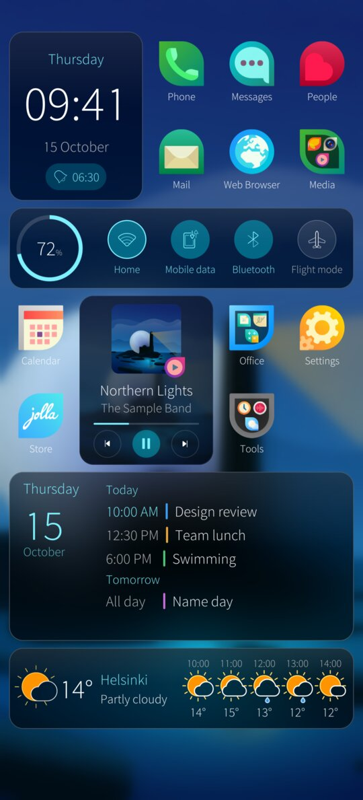
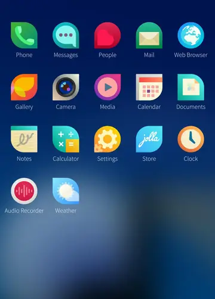
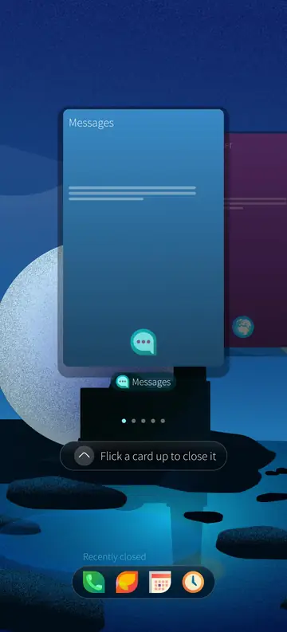
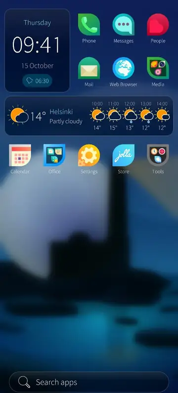
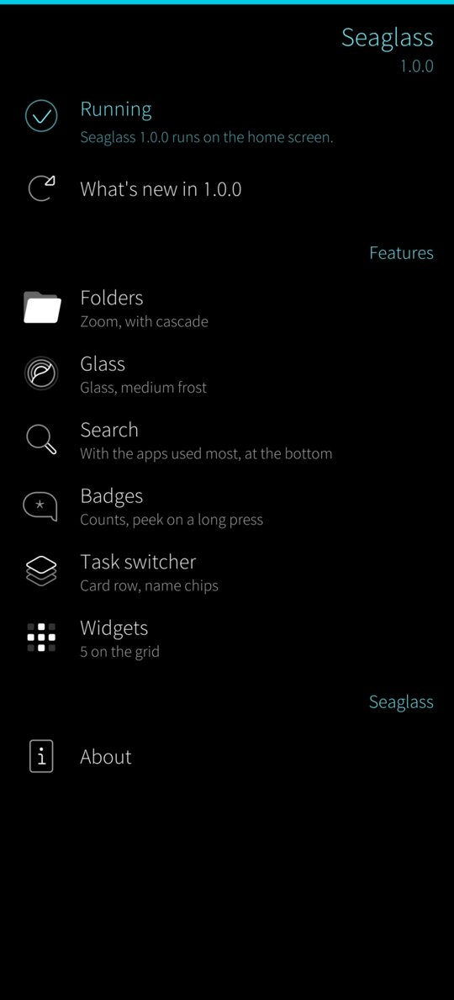

# Seaglass

Home screen extensions for Sailfish OS. They are safe to try and easy to take back.

Seaglass adds widgets, glass, search, notification badges, a richer task switcher and app animations to the stock
Sailfish home screen. Everything is a setting, and everything can be switched off. The home screen's own files are never changed
on disk: a Patchmanager patch of a few lines loads our QML, and the stock home screen stays whenever it cannot.

Tested on a Jolla Phone with Sailfish OS 5.2.0.20 (`lipstick-jolla-home-qt5` 1.27.18.1).

<p align="center">
  
  
  
</p>

The images and animations come from the development harness, which uses only the stock apps, a stock ambience and
sample data.

## Features

**Folder previews.** A launcher folder shows small icons of its apps instead of the bare item count, in its
own shape and colour. While an app is held over a folder, the slot where it will land pulses.

**Folders as widgets.** A folder can open out into a glass tile on the app grid, and its apps
launch with one tap. A tile is a *card* (two by two cells), a *shelf* (the full width, one row) or a *panel* (the
full width, two rows). It sits anywhere among the icons, which flow around it. In the launcher's edit mode it moves
by dragging, changes size and takes apps dropped on it.

**Folder motion.** A folder opens from its icon or widget and closes back into it: *zoom* (the default),
*spring*, *reveal* or *slide*. Its apps ripple in, and the app grid steps back. The stock *fade* is also available.
How the folders work: [docs/FOLDERS.md](docs/FOLDERS.md).

<p align="center"></p>

**Glass.** The app grid rises over the home screen's wallpaper, which stays sharp under it (*Clear*, the default)
or frosts like glass as the grid comes up (*Glass*). The wallpaper eases back as the grid opens and follows the pages
more slowly than the icons; tilt and drift are optional. Another ambience's picture or a photo can take its place
under the grid. Folder icons, open folders and widget cards are glass too, and *Stock* keeps the Sailfish background.
More: [docs/GLASS.md](docs/GLASS.md).

<p align="center"></p>

**App search.** A glass pill on the first page of the app grid, with the five apps you use most. Tapping it
opens a sheet:
- before you type: the apps used most, and every app A–Z with a letter rail;
- as you type: the matches, best first. Accents don't matter; word starts, initials and desktop file names also
  match. *Enter* launches the first match.

More: [docs/SEARCH.md](docs/SEARCH.md).

<p align="center"></p>

**Notification badges.** Apps with notifications show how many on their icons, as a count or a dot. Folders,
cards and the search show them too, and they follow the Events view live. A long press on an app or a folder with
a badge shows its notifications, to open or clear them; *Edit grid* there starts the edit mode. More:
[docs/BADGES.md](docs/BADGES.md).

<p align="center"></p>

**Task switcher.**
- Each cover gets a chip with its app's icon and name.
- A *Recently closed* capsule starts closed apps again.
- An optional card row: the last used app in front, and a card pulled up closes its app.
- A pinch switches between the grid and the card row, following the fingers.

More: [docs/SWITCHER.md](docs/SWITCHER.md).

<p align="center">
  
  
</p>

**Data widgets.** Live information as glass blocks among the icons:
- a *clock*, digital or analogue, with the date and the next alarm;
- the *status*: the battery, and Wi-Fi, mobile data, Bluetooth and flight mode as chips that switch with a tap;
- *now playing*: the album art, the track, the progress and the player's buttons;
- the *next event*: the coming events in their calendars' colours, with an option to hide their details;
- the *weather*: the Weather app's place now, and the next hours or days.

A fresh install starts with the clock and the status. In the edit mode, *Add widget* opens a gallery with live
previews of each size. More: [docs/WIDGETS.md](docs/WIDGETS.md).

<p align="center">
  
  
  
</p>

**App animations.** Apps open from the icon or cover you tapped, show a loading effect on their new cover while they
start, and close with the swipe from the top, in one of nine styles: *Seaglass*, *Tide* and *Northern lights* (calm,
made of glass, water and light), *Ember*, *Volt* and *Frost* (fire, lightning and ice), and *Shatter*, *Singularity*
and *Dust* (loud on purpose). Each moment can have a style of its own, or *Surprise me* picks one each time; a page
with a live preview sets them up. The effects are shaders on a copy of the window, so Sailfish never waits for them.
They are off by default. More: [docs/ANIMATIONS.md](docs/ANIMATIONS.md).

<p align="center">
  
  
  
</p>

What changed in each version: [CHANGELOG.md](CHANGELOG.md).

## Install

You need:
- Sailfish OS 5.2.0.18 or 5.2.0.20. Patchmanager applies the patch only to the versions listed in `patch.json`.
  For 5.1 and 5.0, each release also has a testers' package: CI checks it, but it has not run on such a phone yet.
- Patchmanager 3.2 or newer, from OpenRepos or Chum.

Steps:
1. Install the `seaglass` RPM, from OpenRepos (Storeman) or the
   [releases page](https://github.com/D31m05z/seaglass/releases). From a terminal:
   `devel-su pkcon install-local seaglass-*.noarch.rpm`
2. Open *Settings → Patchmanager*, activate *Seaglass*, and let Patchmanager restart the home screen.
3. Tap *Seaglass* in Patchmanager for its settings. The first page says whether Seaglass runs, and what to do if
   it does not. Each feature has a page of its own, and changes apply at once.

<p align="center"></p>

If the app grid does not come up after you activate the patch, reboot the phone. With Patchmanager's *Activate on
boot* off, the phone starts with the stock home screen.

**Updating.** The package takes the patch out of the home screen before an update. If the patch was active, the
package activates it again afterwards. Then restart the home screen, from Patchmanager's pulley menu or with
`systemctl --user restart lipstick`. Storeman does not show the package's messages, so it won't remind you.

To go back to an older version, deactivate *Seaglass* in Patchmanager first.

**Backup.** *Back up* on the settings' About page saves the settings, the widgets and the folder types to a file in
Documents. *Restore* reads such a file back, on another phone or after a reflash. The order of the apps belongs to
the launcher, and is not in the backup.

**After a Sailfish OS update,** Patchmanager applies the patch only if this version of Seaglass lists the new
Sailfish OS version in its `patch.json`. Otherwise, wait for a version of Seaglass that does.

**Removing.** Deactivate *Seaglass* in Patchmanager, or remove the package: `devel-su rpm -e seaglass`.
Removing the package deactivates the patch first. Folders shown as widgets go back to being ordinary folders, in
their places in the app grid. The settings stay in dconf, in case you install it again; to clear them as well:
`dconf reset -f /apps/seaglass/`

## Privacy

- Seaglass reads only what the stock home screen and its Events view already read: the launcher's apps and
  folders, notifications, the calendar, the media player, the Weather app's saved place, and the connection and
  battery states.
- It stores its settings, the app launch counts and the recently closed apps in dconf (`/apps/seaglass`), on
  the phone only. *Forget used apps* and *Forget closed apps* in the settings clear them.
- It sends nothing anywhere. The weather widget uses the stock weather module, whose requests follow the stock
  Events view's rules.
- It writes nothing to the system journal unless *Debug log* is on.

## Troubleshooting

**The patch is active, but the home screen looks stock.** Patchmanager reaches the home screen through
`/usr/lib64/libpreloadpatchmanager.so` in `/etc/ld.so.preload`. That file belongs to the device adaptation package
(`droid-config-jp2601` on the Jolla Phone). A Sailfish OS update can replace it without Patchmanager's line; this
happened with 5.2.0.20. Patchmanager then still shows its patches as active, but none of them reaches any app. The
package warns about this when it is installed, and so does the first page of Seaglass's settings. To put the line
back, run this as root, then restart the home screen:

```bash
devel-su sh -c "sed -i '/libpreloadpatchmanager/ d' /etc/ld.so.preload; echo /usr/lib64/libpreloadpatchmanager.so >> /etc/ld.so.preload"
```

Reinstalling Patchmanager does the same.

**Debug log.** On the About page of Seaglass's settings (off by default; dconf `/apps/seaglass/debug`).
When it is on, the home screen's journal gets our diagnostics, each line starting with `seaglass:`. These
cover:
- how each notification matched its app (its identity fields, never its text);
- the pinch's timing;
- the grid's corrections.

The switch takes effect at once. Read the lines with `devel-su journalctl -b | grep seaglass:`.

## How it works

```
lipstick-jolla-home-qt5 (stock QML, unchanged on disk)
  └─ Patchmanager applies the hook in memory, in eight stock files
       └─ each hook is a Loader of a file from /usr/share/seaglass/qml/
            failed to load → that part of the home screen stays stock
```

The hook is generated from anchors in the stock files, and it refuses to apply when they move. Only root-owned QML
from the package runs in the home screen. Details are in [docs/ARCHITECTURE.md](docs/ARCHITECTURE.md). Building,
testing and the development harness are covered in [docs/DEVELOPMENT.md](docs/DEVELOPMENT.md).

## Support

Seaglass is free software and stays free. If it makes your phone a little nicer, a coffee on
[Ko-fi](https://ko-fi.com/D31m05z) helps keep it going: new Sailfish OS versions, fixes and new features. The same
page supports the developer's other Sailfish OS apps.

## License

Copyright (C) 2026 Syrtis Major

Seaglass is free software: you can redistribute it and/or modify it under the terms of the GNU General Public
License as published by the Free Software Foundation, either version 3 of the License, or (at your option) any later
version. It comes with no warranty; see [LICENSE](LICENSE) for the details.

The context lines in `patchmanager/diffs/` are excerpts of Jolla's proprietary `lipstick-jolla-home-qt5`, as in
every Patchmanager patch. The GPL does not cover them.
