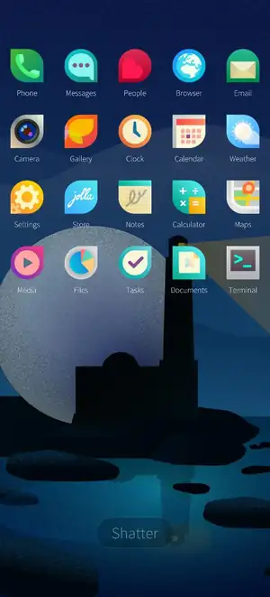
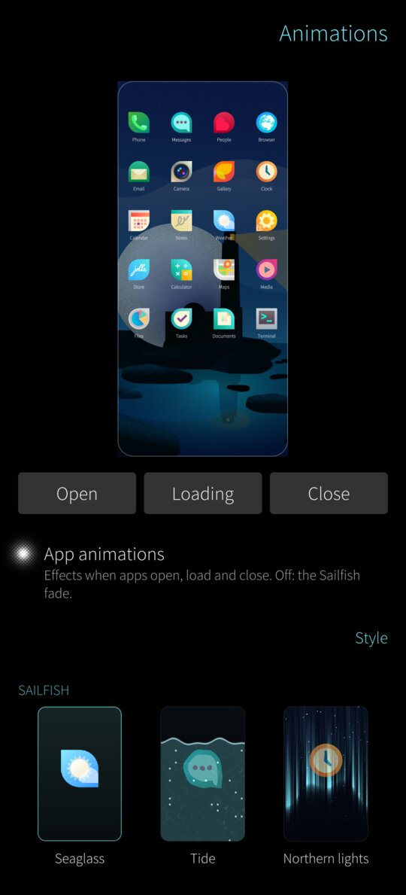

# Animations

Sailfish OS opens an app with a fade, shows a busy indicator on its cover while it starts, and closes it with a slide
and a fade. Seaglass adds styles for these three moments, from paper ones that fold, print or draw the app and calm
ones made of the ambience's glass, water and light to loud ones that burn, shatter or swallow it. Each effect is a
shader on the GPU, played on a copy of the window, so Sailfish never waits for it. Out of the box, apps open in
*Ember*, load in *Dust* and close in *Northern lights*.

<p align="center">
  
  
  
</p>

## What you see

### The moments

- **Opening.** The app's window appears. Stock: a 150 ms pause until the window is drawn, then a 300 ms fade.
- **Loading.** An app that is not running starts. The app grid closes, the switcher gets a new cover for the app, and
  the cover shows the style's loading effect, with the app's icon, instead of the busy indicator. The app then opens
  from that cover.
- **Closing.** A swipe down from the top edge closes the app: the effect starts where the finger let go. Closing a
  cover in the switcher, with its × or *Close all*, plays the closing effect on the cover (*Covers too*).

An app opens from where it was tapped: from its icon in the app grid when it was running already, and from its cover
in the switcher when that was tapped or when it has just loaded there. Anything else (a notification, a link,
another app) opens it from the middle of the screen. Going home with a swipe from the side keeps the stock motion:
the window follows the finger into the switcher, and an effect there would read as closing the app.

### The styles

Twelve styles in four groups, and the stock one. The lengths are at the normal speed.

| Style | Opening | Loading | Closing |
|---|---|---|---|
| **Stock** | Fades in, 300 ms | A busy indicator on the new cover | Slides on and fades out, 300 ms |
| *Paper: folded, printed and drawn* | | | |
| **Contour** | Thin lines in the shape of what it opens from spread outward, and the app comes up in steps between them, 480 ms | Round lines leave the icon over a dark cover | The window draws in to where the finger let go, in steps with a line on each, 520 ms |
| **Fold** | The window comes out of the icon as a narrow pleated strip and opens sideways until it lies flat, 560 ms | The cover is a paper screen with the icon printed on it, and a fold runs across and back | The window folds up from its sides into a narrow strip, which drops away, 600 ms |
| **Halftone** | A screen of dots spreads from the icon; the dots grow, show the app and run together, 600 ms | The icon as a matrix of dots, with rings of larger dots spreading from it | The window breaks into dots from where the finger let go; they shrink and go out, 640 ms |
| *Sailfish: calm, made of glass, water and light* | | | |
| **Seaglass** | Rises from the icon as frosted glass in the ambience's colour and clears as it lands, 480 ms | A glass cover in the ambience's colour; a light runs round its edge, a glint crosses it and the icon breathes | Frosts over, rounds into a pebble and sinks; a ring spreads where it went in, 560 ms |
| **Tide** | A drop lands on the icon and throws a crown of droplets; the app spreads in its ripple, 650 ms | Water rises in the cover over the icon, with caustics and bubbles | A wave rolls up from the bottom and washes it away under a lip of foam, 720 ms |
| **Northern lights** | A thin ray rises from the icon, and curtains of aurora sweep down and leave the app behind them, 780 ms | An aurora over dark hills and a still lake that mirrors it | Melts upward into rays of light that rise and fade, 850 ms |
| *Elements: fire, lightning and ice* | | | |
| **Ember** | A ring of fire spreads from the icon, sparks flying ahead of it, 620 ms | The cover smoulders: coals, low flames, rising sparks | Burns away from the bottom up: charring, a glowing edge, flames and heat haze, 880 ms |
| **Volt** | Lightning strikes the icon and lights up the screen around it, then an electric ring opens the app, 620 ms | Arcs run around the cover's edge, and now and then a bolt strikes the icon | Arcs crawl over the window, then it switches off like an old TV, 700 ms |
| **Frost** | Frost forms over the screen and melts away from the icon outward, 700 ms | Frost grows over the cover from its edges and thaws again | Freezes from the edges, cracks from where the finger let go, and falls apart as snow, 950 ms |
| *Extreme: loud on purpose* | | | |
| **Shatter** | Shards burst out of the icon and fit together into the app; the seams glow and vanish, 720 ms | The cover cracks from a point on the icon; the cracks fill with gold and heal | Breaks where the finger let go; the shards fall, turning and catching the light, 1000 ms |
| **Singularity** | The app bursts out of a white hole at the icon, 660 ms | A small black hole spins in the cover, bending the icon around it | Pulled into a black hole with a glowing disk, which then winks out, 950 ms |
| **Dust** | Sand blows in and settles into the app, from the icon outward, 800 ms | Sand pours through the cover into a heap | Crumbles from the top down into dust that the wind takes, 1050 ms |

With *Ambience colours* on (the default), fire, water, ice and light, and the ink and paper of the Paper styles, take
the ambience's highlight colour: a blue ambience burns blue. Off, they have their natural colours. Tide's water keeps
its own deep colour either way, and only its light takes the ambience's. Seaglass is always in the ambience's colour.

### The settings

*Settings → Patchmanager → Seaglass → Animations*. The row on the first page shows the style of each moment,
*Surprise me* or *Off*.

<p align="center"></p>

- **App animations.** On or off. Off is the stock behaviour.
- **The sheet.** Every style's opening, loading and closing at once, as still frames: a row for each style, *Stock*
  first and then the styles in their groups, and a column for each moment. Each frame catches its moment at a point
  that tells it apart, on a made-up home screen: an opening or a closing as a band of the screen, a loading on its
  cover. Over each column are its moment and its style, *Stock* or *Surprise me*. The frame of the style set for each
  moment has a highlighted edge, faint while the animations are off, as what would play; with *Surprise me* only a
  moment set to *Stock* keeps it. Once the heads have scrolled away, the moments' names stay at the top. Nothing on
  the sheet moves.
- **A tap on the sheet** opens the viewer. On a frame it plays that moment once. On a style's name it plays a round:
  the loading, the opening from the cover it loaded on, a moment of the app, and the closing. On a moment's head it
  plays a tour: that moment in every style in turn, from *Stock* down; a touch ends the tour on the style it is at.

Under the sheet (in landscape, beside it), *Feel*:

- **Speed.** *Relaxed* (×1.35), *Normal* or *Quick* (×0.72, the default).
- **Surprise me.** A different style each time an app opens, loads or closes (never *Stock*). A moment set to
  *Stock* stays stock.
- **Ambience colours.** As above.
- **Covers too.** Closing a cover in the switcher, or all of them, plays the closing effect on the covers. Off, they
  close the stock way.

The viewer shows one style at a time, large, on the made-up home screen over the ambience's picture: its name, a line
about it, what the moment plays now (*In use: Ember*, *In use: Stock*, *In use: Surprise me* or *Off*) and the
length of an opening or closing at the set speed. It plays the moment when it opens, and again on a tap.

- **Swipes.** Sideways to the next or previous style, whose stills peek in at the sides; up or down back to the sheet.
  A swipe stops what plays, and the style it lands on plays once. A tap on *In use* goes to the style it names.
- **Tabs.** *Opening*, *Loading* and *Closing*: the same style at another moment.
- **The strip.** Seven stills of the moment under the stage, from its start to its end, with the point the stage shows
  marked. A press jumps to a point and a drag scrubs through the moment; where the finger lifts, the large still is
  made at that point, and it stays there until the style or the moment changes.
- **Slow.** Plays four times as long, for looking only. It is not saved, and goes with the page.
- **Speed.** Steps through *Relaxed*, *Normal* and *Quick*, saves the setting at once and plays again: speed can only
  be judged while watching.
- **Use for opening** (*loading*, *closing*) sets that moment to the style shown, or to *Stock*. For a style it also
  turns the animations on and *Surprise me* off.
- **Use for all three** sets every moment to the style shown: the *Style* to it and each moment to `""`, which follows
  the *Style*, or for *Stock* each moment to `stock`. It turns *Surprise me* off, and for a style turns the animations
  on.

Looking changes no setting. Swipes, taps, the tabs, the strip and *Slow* write nothing, and the viewer plays what it
shows whether the animations are on or off. Only the Use buttons and *Speed* write; a Use button that would change
nothing reads *In use*, and the viewer stays open after a tap on one. A run stops at once when the Settings app goes
to the background, the page is swiped back or the phone turns, and it does not start again by itself.

Both pages make their stills one at a time, and only at rest: each is a moment drawn on the made-up home screen for
a few frames and kept as a texture. On the sheet they then become one picture, which the page keeps in `~/.cache` as
`seaglass-animations-tinted.jpg` (with *Ambience colours* on) or `seaglass-animations-natural.jpg`, with a `.key` file
beside it that says what it was made for. A later visit shows that picture and makes no stills. The picture holds
only the made-up app and stock icons over a neutral gradient, never the ambience's picture. A stale picture is not
used: when the effects or the stills have changed since it was made (in an update of Seaglass), or the ambience's
colour, a light or dark ambience or the screen, the page makes the stills again and saves over it. The files can be
deleted by hand at any time, and the page makes them again on its next visit. Nothing removes them when Seaglass is
removed, or on *Reset settings*.

The settings are in dconf under `/apps/seaglass/animations`, and the home screen follows them live:

| Setting | Key | Default | Values |
|---|---|---|---|
| App animations | `enabled` | true | |
| Style | `style` | `ember` | `contour`, `fold`, `halftone`, `seaglass`, `tide`, `aurora`, `ember`, `volt`, `frost`, `shatter`, `singularity`, `dust`, `stock` |
| Opening, Loading, Closing | `open`, `loading`, `close` | `ember`, `dust`, `aurora` | `""` (same as style), `stock` or a style |
| Surprise me | `surprise` | false | |
| Speed | `speed` | 2 | 0 relaxed, 1 normal, 2 quick |
| Ambience colours | `ambience` | true | |
| Covers too | `covers` | true | |

Reset, backup and restore cover the group like the others.

## How it works

Three rules hold for every effect:

- **Sailfish is never kept waiting.** The window is shown, focused and closed at the stock moment. The effect plays on
  a copy of it, over or in place of the stock layer, and touch goes to the app as soon as the stock would let it.
- **One shader per effect.** Each effect is a `ShaderEffect` with one fragment shader and the same inputs: the layer
  as a texture, a 256 × 256 noise tile, `progress` from 0 to 1, `time` in seconds, the origin point, rectangle and
  corner radius, the aspect ratio, the size in pixels, the ambience's highlight colour and whether to use it. While
  an app opens or closes, `time` runs from 0 to the effect's length in seconds beside `progress`, so it follows the
  speed; a loading effect has a clock that runs on. Frost's opening and closing also read what their field baked,
  and Shatter has a pair of shaders of its own (below).
- **Stock when anything fails.** No controller, a shader not loaded yet, a style that does not load: the stock fade,
  indicator and slide run as before. The hook changes stock values only through what our files return.

### The hook

Two more stock files, and two that were hooked already ([ARCHITECTURE.md](ARCHITECTURE.md)):

```
compositor.qml
  ├─ transitions    Loader → animations/AnimationController.qml    failed → the stock opening and closing
  │                 right after the app layer, under the dialog and alarm layers;
  │                 appLayerItem gets `seaglassTransitions: <the loaded item>`
  └─ seaglassAboveLayers   an empty Item above the layers (z 1), where the closing effects play
layers/StackLayer.qml
  ├─ property QtObject seaglassTransitions: null                     (set only on the app layer)
  ├─ showAnimation: before the FadeAnimator, a ScriptAction calls seaglassTransitions.opening(layer)
  └─ transitioning: also true while the effect plays, so that lipstick keeps drawing the home screen under it
switcher/Switcher.qml       SwitcherController.qml finds the cover an app opens from (no new lines)
switcher/SwitcherItem.qml
  ├─ loading        Loader → animations/CoverLoading.qml            failed → the stock busy indicator
  │                 the busy indicator and the icon stay hidden only while its effect plays
  └─ close()        first calls seaglassSwitcher.item.coverClosing(wrapper)
```

### Opening

`StackLayer`'s show animation waits 150 ms, then until the window is mapped, then fades the layer in over 300 ms.
The hook's step before the fade calls `AnimationController.opening(layer)`, on the pass that fades only (the stock
restarts the animation while the window is not mapped, with `retries` above 0). The controller:

1. picks the style for *Opening*, or answers `false` (off, stock, or its shader not loaded yet);
2. takes the origin: the icon that `HomeController.qml` noted when it launched an app, within the last 3 s and
   while the app grid is still out, else the cover the app has in the switcher (`SwitcherController.coverRectFor`,
   which also finds a cover that is still loading, by its app), else the middle of the screen. Its corner radius
   goes with it: half the icon's width (launcher icons are round), the cover's corners as the switcher draws them,
   or none from the middle;
3. puts a live `ShaderEffectSource` on the app layer (`hideSource`, so that the layer is not drawn twice) under the
   effect, and plays the effect on the render thread (below);
4. lets the layer show again when the effect has ended.

The stock fade runs on underneath, unseen: a running animation keeps the durations it started with, so it cannot be
cut short from inside, and the copy leaves out the layer's own opacity, which is what the fade changes. While the
effect plays, the hook keeps the layer `transitioning`; otherwise lipstick sees an opaque app layer and stops drawing
the home screen under the half-open app.

### Loading

`Switcher.activateWindowFor` makes the launching cover and goes to the switcher. In each cover a `Loader` holds
`CoverLoading.qml` while the cover is launching. It picks the style for *Loading* once, and draws the style's loading
shader over the cover, with the app's icon as its texture and `time` running on the render thread. For *Stock* it
makes no icon, texture or effect, and the busy indicator shows. When the window is mapped, the cover stops
launching, the Loader lets go of the effect, and the opening effect starts from this cover.

### Closing

The controller listens for two signs of a committed close: the app layer's `peekFilter.gestureTriggered` with
`topActive`, and the layer itself closing a window (`closing` with a `closingWindowId`). The first one to come calls
`closing()` once. Then it

1. renders the window once into a `ShaderEffectSource` (`live: false`) from the layer's `snapshotSource`: the whole
   window, without the stock fade and wipe;
2. hides the whole app layer through a second, unused `ShaderEffectSource` (`hideSource`) while the stock close runs
   on underneath, for at most 800 ms;
3. plays the effect in `seaglassAboveLayers`. The window first comes back from where the swipe left it (its wiped top
   edge and its fade, whole again in 180 ms, on the render thread too) while the effect takes it away. A new app
   shown meanwhile appears normally under it.

The effect cannot play in the app layer's own overlay: `peekLayer`, which holds the app layer, hides as soon as the
stock close is over, and most effects last longer.

A cover closed in the switcher calls `coverClosing(wrapper)` before the stock animation, which fades the cover and
drops it a little in 200 ms. SwitcherController puts `CoverClosing.qml` at the cover's place, in the item that holds
the covers. The stock removes the cover's delegate after 200 ms, and a `ShaderEffectSource` loses its picture with its
source item, so the frozen cover is copied once more, in the same frame, into a picture of its own, which is all the
effect reads. `CoverClosing.qml` goes when its effect has ended, or after 1.5 s if its shader never comes. A window
that closed with its own swipe has played its effect already, so its cover closes the stock way (`motion.js`,
`noteWindowClosing`).

### On the render thread

The home screen's GUI thread is busiest while an app starts, which is when an opening plays. So an effect plays on
Qt's render thread: `Effect.play(ms)` runs `progress` from 0 to 1, and `time` from 0 to the length in seconds, with a
`UniformAnimator` each, which set the shader's uniforms as each frame is drawn. `time` is a uniform of its own, not
worked out from `progress`. A split moment's second pass (below) has animators of its own: with animators on the
first pass alone, its grains would stay where they start. A loading's clock (`runClock`) runs until its cover goes.
The vertex shader declares neither `progress` nor `time`: an animator does not drive a uniform that both stages
declare.

`halt()` ends a run, and `ended` comes once after a run of `play()` ends or is halted: that is where the controller
lets go of the window's copy and shows the layer again, and where a cover's closing removes itself. A loading's clock
ends without it. While a run plays, the GUI side keeps the old `progress` and `time`, and nothing from the GUI thread
writes a uniform of an effect that runs: a write in the frame after its end would put the GUI side's values back into
the effect for a frame. So the closing window's way back to whole runs on animators too.

A render thread that draws no frames, as with the display off, never ends a run, and a closing effect that still runs
keeps the next close from playing. So each run also has a timer on the GUI side that halts it half a second after its
length. The display going off (`displayAboutToBeOff`) ends every effect at once anyway, as the stock does with its
transitions.

The settings' viewer drives its effects from the GUI thread instead (`AnimationStage.qml`): pausing, scrubbing and
*Slow* want one value there that they can all set.

### Shatter

A pane broken at a point: 11 rays from it and rings at 0.05 to 1.5 screen heights, every cell split into two
triangles, 165 shards, each with its own delay (by its distance from the point), throw, gravity and turn about a
random axis, drawn in perspective with a glint where it faces the light. Each triangle knows how its edges broke, so
the cracks out from the point are drawn brightest and the cuts that split a cell faintest. All the shards are one
`ShaderEffect` over a `GridMesh` of one row, three of its columns to a shard: `shaders/shards.vert` puts their
vertices on the shard's corners so that its triangle is the only one with an area, works out which shard and corner
each vertex is from its texture coordinate and the whole break from one seed, and turns and moves it.
`shaders/shards.frag` draws the triangle with its seams. No shard has an item or data of its own; a new break is a new
seed (`Shards.qml`, `build()`). `progress` is in the vertex shader only, so that an animator drives it. A cover breaks
into 9 rays and 5 rings, 81 shards. An app opens the other way: each shard leaves the icon small and turning and lands
in its place, the near ones first.

### Grains: Dust and Frost

The grains are not separate items. Each pixel asks which grain covers it now: for four speed classes it steps back
along the grain's path (its start from the sweep and the noise, then drift and gravity), checks that the grain there
belongs to that class and has started, and draws it if it lands on the pixel (`grains.glsl`; Frost's snow finds its
flakes the same way, in `frost.glsl`). That is about 20 texture reads a pixel, so the moments with grains or snow
draw them at half the resolution (`layer.textureSize`) and scale them up, which grains do not mind: Dust's opening
and closing, and Frost's closing (`half` in `styles.js`, per moment; the two styles' loading effects are drawn at
half too). Through the half-size layer the window would also look soft at the start of a close, and the app at the
end of an open would sharpen at once when the effect ended. So these three moments are split (`split`): `Effect.qml`
draws the picture at full resolution and only the grains at half, in a second pass of the same shader over it, and
the shader reads `part` to know which of the two it draws. Only an effect of a split moment has that pass. Frost's
closing has no snow before its middle, and its second pass draws nothing until then (`grainsFrom`). Frost's opening
has no grains and draws at full resolution.

### Frost's field

Frost's pattern does not change while it plays, and the picture a closing freezes holds still. So Frost's opening and
closing do not work them out for every pixel in every frame. At the start of a run, `FrostField.qml` draws
`shaders/frost-field.frag` once into a texture the size of the effect: the frost pattern, a closing's thin cracks,
and where a rime dot shows. For a closing it draws the picture blurred into a second one. The moment reads them as
`fieldTex` and `blurTex` (`field` in `styles.js`, per moment: Frost's loading works its pattern out as it goes). The
melting edge still reads the noise as it plays: kept in 8 bits, it would come out in terraces. The textures go when
the run ends and are made again at the start of the next, so that the controller's effects do not hold them for as
long as Frost is chosen. `Effect.qml` loads the field by URL in a `Loader`, because a type cannot contain itself, and
makes that `Loader` only for a moment with a field; without a field, the noise tile stands in, since a texture input
that goes to null makes Qt warn. A still of such a moment on the settings pages shows its effect, and so makes the
field, a frame after the effect itself, so that the GUI thread does not make the two in one go.

### The shaders

The shaders are files: `shaders/STYLE-open.frag`, `-load.frag` and `-close.frag`, behind `shaders/common.glsl` (the
inputs, noise, easing, rounded rectangles, the blur, the tint) and the style's libraries (`aurora.glsl`, `ember.glsl`,
`volt.glsl`, `frost.glsl`, `grains.glsl`). `shaders.js` reads each file once with `XMLHttpRequest` (Qt 5.6 reads
local files), however many shaders it goes into, and keeps it and each shader's text for the QML engine. They are
GLSL ES 1.00. Where the GPU has OpenGL ES 3 (the Jolla Phone's Mali-G610 does), `Effect.qml` runs them as GLSL ES 3.00
with a vertex shader of its own: `shaders.js` puts `#version 300 es` and `#define ES3` in front, and the styles that
blur read a mipmap level of the window's copy (`textureLod`), which has mipmaps for them only. The blur reads a whole
level, which each pixel's own dither rounds up or down, and its taps are turned by an angle of each pixel's own, so
the level's texels never line up into squares; what is left is a fine grain, as on frosted glass. Most shaders return
early where a pixel has nothing to draw, and do their costly part only where it shows. The noise tile has three
channels of data: smooth noise, fractal noise and the distance to the nearest Voronoi edge. Its alpha is opaque,
because Qt premultiplies a picture by it, so the shaders make their white noise themselves. `scripts/noise.py` makes
it when the package is built.

### Warm-up

Compiling a shader can stall a frame. When the home screen starts, and again when the settings change, the controller
reads only the shaders the settings can pick: every style's with *Surprise me*, else the chosen ones, with Frost's
field when Frost opens or closes. From 3 s on it compiles them one every 150 ms, a pixel large and nearly clear, and
Shatter's shards the same way when Shatter can play. Until a moment's shader is read, that moment plays the stock
way. With the animations off, nothing is read or compiled, and the noise tile is not loaded.

## Costs

- **Only while something moves.** The effects draw only while they play. The overlay is empty otherwise, and a
  cover's loading `Loader` is active only while the cover is launching. On the settings pages nothing moves at rest:
  the sheet is textures or one picture, and the viewer hides its live scene between runs.
- **Budget.** One full-screen pass for the effect and one capture of the layer: live while opening, once when closing.
  A split moment adds a second pass at half the resolution for its grains, and Frost's opening and closing draw their
  field once, at the start of a run.

## Limits

- `ShaderEffect.status` cannot tell whether a shader works: on Sailfish OS 5.2 it reads `Error` for shaders that
  compiled and draw. A shader that does not compile draws nothing, and Qt says so in the log
  (`QOpenGLShader::compile`). `make lint` compiles every shader with `glslangValidator`, as GLSL ES 1.00 and 3.00.
- Without OpenGL ES 3 the blur has no mipmaps: it takes nine texels of the full-size copy, and under thick frost
  (*Seaglass*, *Frost*) text can show double. The Jolla Phone has OpenGL ES 3.
- With *Cards* as the switcher's layout, covers close the stock way.
- The busy indicator on an app grid icon (shown in a rare case, when the app grid stays open while an app starts)
  keeps its stock look.
- Without the closing effect's shader loaded, a cover closes the stock way (it would vanish otherwise).
- The effects have not been measured on phones weaker than the Jolla Phone. The viewer in the settings lowers the
  size it plays a moment at by itself: after a run that stutters, the next run of that moment draws smaller and is
  scaled up, for as long as the page is open.

## The code

- [AnimationController.qml](../qml/animations/AnimationController.qml): the compositor's overlay: opening, closing,
  the warm-up, the settings.
- [Effect.qml](../qml/animations/Effect.qml): a `ShaderEffect` for a style and moment, which loads its shader and
  plays it on the render thread. [FrostField.qml](../qml/animations/FrostField.qml): Frost's field, baked at the start
  of a run.
- [Shards.qml](../qml/animations/Shards.qml): Shatter's shards. [NoiseTile.qml](../qml/animations/NoiseTile.qml): the
  noise tile as a texture that repeats.
- [CoverLoading.qml](../qml/animations/CoverLoading.qml), [CoverClosing.qml](../qml/animations/CoverClosing.qml): the
  effects on the switcher's covers.
- [styles.js](../qml/animations/styles.js): the styles, their groups and lengths, and how a moment's style is
  chosen. [shaders.js](../qml/animations/shaders.js): reading the shaders.
- [shaders/](../qml/animations/shaders/): the shaders.
- [AnimationsPage.qml](../qml/settings/AnimationsPage.qml): the settings page with its sheet.
  [AnimationSheetBuilder.qml](../qml/settings/AnimationSheetBuilder.qml) makes the sheet's frames,
  [AnimationSheetPicture.qml](../qml/settings/AnimationSheetPicture.qml) turns them into one picture and keeps it, and
  [AnimationFeel.qml](../qml/settings/AnimationFeel.qml) holds the settings under the sheet. The page loads the three
  from their files once it is on top, one after another, so that opening it compiles only what it shows first. The
  settings' first page ([SettingsHub.qml](../qml/settings/SettingsHub.qml)) compiles the page itself in the
  background a second after it opens, so that a tap on its row does not wait for that.
- [AnimationViewerPage.qml](../qml/settings/AnimationViewerPage.qml): the viewer, with its live scene
  ([AnimationStage.qml](../qml/settings/AnimationStage.qml)) and its strip
  ([AnimationStrip.qml](../qml/settings/AnimationStrip.qml)).
- [FrozenFrame.qml](../qml/settings/FrozenFrame.qml): one still of a moment as a texture, and
  [FreezeQueue.qml](../qml/settings/FreezeQueue.qml), which makes them one at a time, a frame or more apart; both
  count frames with [FrameCounter.qml](../qml/settings/FrameCounter.qml), an animation, since a Timer ends by its own
  clock while nothing else animates. [PreviewKit.qml](../qml/settings/PreviewKit.qml): the made-up home screen they
  are drawn on, with its made-up app ([NotesPreview.qml](../qml/settings/NotesPreview.qml)).
- [stills.js](../qml/settings/stills.js): where each still is caught, the size the viewer plays each moment at, and
  the viewer's line about each style. [AnimationSettings.qml](../qml/settings/AnimationSettings.qml): the dconf keys.
- [apply_hook.py](../hook/apply_hook.py): `hook_compositor`, `hook_stack_layer`, and the loading and closing in
  `hook_switcher_item`.
- The harness: the `animations` scene draws one effect or checks that every shader compiles; the `reel` scene plays
  styles one after the other for the WebPs above; with `--stack`, the `push` and `viewer` scenes push the settings
  page and its viewer on a real page stack (`push from=hub` pushes it from the settings' first page, as the Settings
  app does); the `bench` scene measures what the effects and the settings page cost on the phone
  ([DEVELOPMENT.md](DEVELOPMENT.md)).
