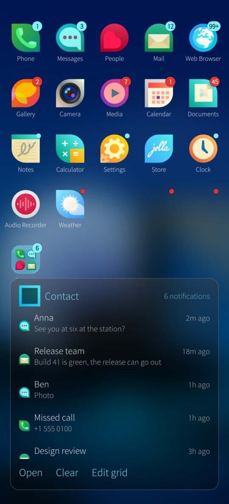

# Badges

The stock app grid does not show which apps have notifications. Seaglass puts a badge on their icons, and on
folders, cards and the search. Holding a badged app or folder shows its notifications.

## What you see

A badge counts the app's notifications in the Events view, up to 99+. A notification for five messages counts as
five. A folder shows the sum of its apps, and the search capsule shows dots. The settings are on the *Badges* page
(*Settings → Patchmanager → Seaglass*), in dconf under `/apps/seaglass/badges`:

| Setting | Key | Values (default first) |
|---|---|---|
| *Notification badges* | `show` | on, off |
| *Style* | `style` | `count`, `dot` |
| *Colour* | `tone` | `accent` (the ambience's highlight colour), `red` |
| *On folders and cards* | `folders` | on, off (off hides the folder sums and the badges on cards) |
| *Long press shows notifications* | `peek` | on, off |

With the peek on, a long press on a badged app or folder opens a glass card by it, instead of the edit mode. The card
lists the notifications newest first: an app's own, or a folder's apps' together, each with its app's icon. Four and a
half fit; more scroll. A tap on one runs its own action, as in the Events view. *Open* runs the newest one's action
(or opens the app; for a folder, opens the folder), *Clear* removes the removable ones, and *Edit grid* starts the
edit mode the long press would have started. An icon without a badge keeps the stock long press.

## How it works

[BadgeSource.qml](../qml/badges/BadgeSource.qml) reads the home screen's own `JollaNotificationListModel`
(`com.jolla.lipstick`), the model behind the Events view, with its filter (no `x-nemo.system-update`), so the two
agree. `HomeController.qml` loads it through a `Loader`, as the module exists only inside Lipstick.

A notification does not name its launcher item. The source tries these, and the first match wins:

1. the `x-nemo-origin-package` hint against the app's `X-apkd-packageName` (Android apps);
2. `owner` (or the `x-nemo-owner` hint) against the desktop file's name;
3. the file name of `appIcon` against the app's `iconId`;
4. `appName`, then `disambiguatedAppName`, against the app's title, ignoring case and accents.

Unique fields come first. When two apps share an icon or a title, the later one in the launcher wins. The apps and
their folders come from the search's entries ([SEARCH.md](SEARCH.md)). Any change restarts a 200 ms timer, then
the source counts again. Each notification adds its `itemCount`, or 1. Badges read `badgeCount(item)` through a
revision number, so they update once per count.

[IconBadge.qml](../qml/badges/IconBadge.qml) puts a [Badge.qml](../qml/badges/Badge.qml) on an icon's corner. The
hook ([ARCHITECTURE.md](ARCHITECTURE.md)) adds two things to the `LauncherGrid.qml` delegate:
- a `Loader` of `IconBadge.qml` as the last child of `LauncherIcon`, so the badge moves and scales with the icon;
- at the start of `onPressAndHold`, a return when the app's badge or the folder's preview
  ([FolderPreview.qml](../qml/folders/FolderPreview.qml), which draws a folder's badge) opened the peek. Without a
  badge, or without a peek, the stock long press runs.

The peek opens when the long press fires, not on release: waiting for the release would mean changing the stock
drag code. Folder icons, cards and the search add their badges in our own files, with no more hook lines. A folder's
notifications are its apps', gathered from the search's entries (the apps with that folder's title).

While the card is open, the pager stands still, and so does the compositor's `launcherInteractiveArea`, which would
otherwise take a pull down on the list and close the app grid ([WIDGETS.md](WIDGETS.md) does the same for the
gallery).

### Checking the matching

The harness has no notification manager, so matching is checked on the phone. Turn on *Debug log* (the *About*
page of the settings). Each notification is then logged once with its identity fields, the desktop file it matched
(`matched`, or `-`) and the rule (`by`), never its text. Each count adds a line such as
`seaglass: badges 4 apps, 9 notifications, 1 without an app`. With a few notifications waiting, run
`make journal` ([DEVELOPMENT.md](DEVELOPMENT.md)). With *Debug log* off, none of this runs.

## Costs

A second notification model in the home screen, listing the same objects as the Events view's. A recount after a
change, one pass over the apps and one over the notifications. A hidden badge in each app icon, drawn only when
there is a notification.

## Limits

- A notification that matches no app gets no badge: mostly system services, or apps whose notifications name
  neither their desktop file, icon nor title.
- A badge stays until the app removes its notifications or they are cleared in the Events view. *Clear* leaves the
  ones that cannot be removed.
- Folder sums go by title, so two folders with the same title show the same sum.
- The peek opens from app and folder icons in the app grid and from apps in open folders, not from cards or the
  search. With it on, a badged app or folder is moved from *Edit grid*.

## The code

- [BadgeSource.qml](../qml/badges/BadgeSource.qml): the model, the matching, the counting and the debug lines.
- [NotificationPeek.qml](../qml/badges/NotificationPeek.qml): the peek card.
- [HomeController.qml](../qml/core/HomeController.qml): `badgeCount()`, `peekAt()`, *Open* and *Clear*.
- [FolderPreview.qml](../qml/folders/FolderPreview.qml): a folder's badge, and its `peek()` for the hook.
- [BadgeSettings.qml](../qml/settings/BadgeSettings.qml) and [BadgesPage.qml](../qml/settings/BadgesPage.qml).
