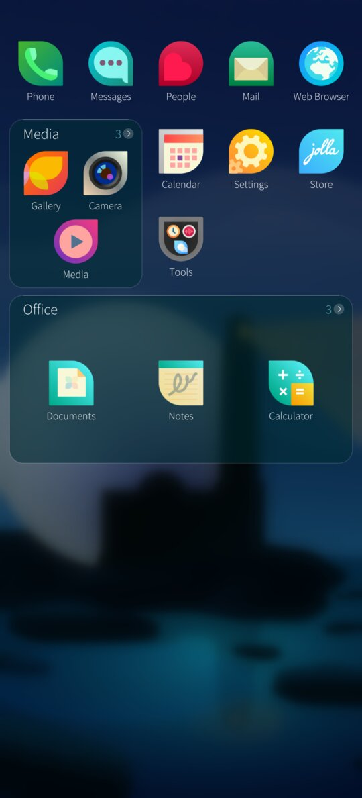

# Folders

Seaglass changes how launcher folders look and move. A folder icon shows small icons of its apps instead of the item
count. A folder can also be shown open on the app grid, as a glass widget whose apps launch with one tap. In edit mode
a widget moves and changes size like an icon, and the icons flow around it. A folder opens out of its icon or widget
and closes back into it.

A widget is only a way of showing a folder. Without Seaglass it is a folder icon again, at the same place in the grid.

## What you see

### Previews

Up to four apps show as 2 × 2 icons, more as 3 × 3, and past nine the last slot shows "+N". While an app is dragged
over a folder, the slot where it will land pulses. There is no switch for previews. With the glass on, the folder is a
glass tile that glows in the colour of its shape ([GLASS.md](GLASS.md)).

### Widgets

A folder shows as an *icon* (one cell, the default), a *card* (two by two cells), a *shelf* (the grid's full width, one
row) or a *panel* (the full width, two rows). On the Jolla Phone's grid of 5 × 9 cells, a card is 400 × 500 px and a
panel 1000 × 500 px. The type is chosen in an open folder: tap its icon, and *On the home screen*, below the folder
shapes, offers the four as small sketches. In edit mode, a round badge on the top right corner of a folder icon turns
it into a card, and a glass pill at the bottom of a widget changes its size or makes it an icon again.

A widget shows the folder's name and number of apps on top (a tap opens the folder) and the apps below. They get the
biggest icons at which they all fit, between two thirds of the launcher's icon size and the full size. When they don't
fit, the last slot shows "+N" and opens the folder. A long press starts the edit mode, as on an icon.

In edit mode the apps of a widget step back and don't launch, and the widget is dragged like an icon: it lifts with a
shadow, its place stays outlined, and the icons slide out of its way. It lifts to 1.04, because a large tile at the
icons' 1.3 would cover half the page. An app dragged over the middle of a widget goes into the folder, and over its
left or right quarter it goes before or after the widget, as with folder icons.

### Opening a folder

The motion is set in *Settings → Patchmanager → Seaglass → Folders*, which has a live preview. The keys are in dconf
under `/apps/seaglass/motion/`, and a folder reads them when it opens.

| Setting | Key | Default | |
|---|---|---|---|
| Animation | `style` | Zoom | Zoom, Spring, Reveal, Slide, or Fade (the stock one) |
| Cascade | `cascade` | on | the apps ripple in from the icon |
| Depth | `depth` | on | the app grid steps back behind the open folder |
| Speed | `speed` | Normal (1.0) | Fast (0.7) or Relaxed (1.4), a factor on every duration |

Zoom, Spring and Reveal open the folder out of its icon or widget and close it back into it. Slide raises it from the
bottom. With Fade the other settings do nothing.

## How it works

### The hook

The general rules are in [ARCHITECTURE.md](ARCHITECTURE.md). Besides its `Loader`s, the hook changes these values:

- `launcher/LauncherGrid.qml`: each delegate draws the block the controller's layout gives it (`targetX`, `targetY`,
  `targetWidth`, `targetHeight`), but keeps the stock cell size itself. The GridView scrolls to show the whole current
  item, which the stock press sets, so a delegate the size of a widget would scroll the grid by rows.
  `gridManager.itemAt()` asks the controller, and a `footer` as high as the rows the widgets add makes `Launcher.qml`
  count enough pages.
- `main/EditableGridDelegate.qml` (the task switcher's covers use it too): `targetX`, `targetWidth` and
  `targetHeight` join the stock `targetY` wherever the item is drawn, with the stock values as defaults. The reorder
  logic, `moved()`, compares drawn positions, where stock mixes them with the GridView's (with widgets they differ by
  whole rows). The pager turns when the dragged item's bottom reaches the page's, so the hook counts at most one cell
  of a widget's height.
- `launcher/LauncherFolder.qml`: the stock opacity `Behavior` and `opacity = 1.0` are off while our motion manages the
  folder, and `close()` asks the motion first.

Qt 5's `Binding` gives back a binding when its `when` turns false, but not a plain value. So the hook binds the folder
icon's `visible`, which has no stock binding, for good: true whenever no tile is loaded.

### Folder types

`FolderTypes.qml` keeps the types in dconf, `/apps/seaglass/folder_types`, as JSON from a folder's title to its
type: `{"Office": "panel", "Media": "card"}`. A folder that is not listed is an icon. The key is the title because QML
sees no stable id for a folder. A `LauncherFolderItem` has `title`, `iconId`, `itemCount`, `type` and `isUpdating`,
but not the name of its `.directory` file. The controller follows renames.

A tile launches an app the way the grid's delegate does (`LauncherActions.qml`), and opens its folder with the grid's
`showFolder()`. Its glass is Lipstick's cover material (`CoverBackground.qml`), or with *Glass → Widget cards* on, the
frosted wallpaper.

### The layout

[grid.js](../qml/core/grid.js) gives every item of the model a block: one cell, or a widget's span. It places them in
model order, each at the first free place (top to bottom, left to right) where its block fits without crossing a page.
This is `grid-auto-flow: dense` in CSS terms. The icons after a card fill the cells beside it, and a card that doesn't
fit in a row starts on the next one while the following icons fill the gap. The grid has no holes.

A widget's place is its folder's place in the model, which Lipstick stores (`applications.menu`). So Seaglass keeps no
positions of its own, and moving a widget is the stock `launcherModel.move` of its folder. Data widgets have no folder
and hold slots in the same order ([WIDGETS.md](WIDGETS.md)). The first page can keep a row free for the stock
experimental clock or the search row ([SEARCH.md](SEARCH.md)).

`Launcher.qml` makes the grid only as tall as its stock rows, so with the footer the grid could scroll inside the pager
and hide its top rows. The controller binds the grid's height to its content while there is a footer, and puts
`contentY` back should anything scroll it (with a line in the journal when *Debug log* is on).

### Dragging

The stock drag stays in charge, and the controller answers its questions. While a widget is dragged, `moved()` asks
`gridManager.itemAt()` what lies under its centre. The controller takes the cell under the widget's top left corner,
and `bestIndex` in grid.js picks the place in the order whose layout puts the widget nearest to that cell. A row
counts more than a column, and a tie goes to the place nearest to where it is, so the widget doesn't jump. This is how
two cards end up side by side. The answer is a stand-in that `moved()` reads as "before item N". It poses as a full
folder (99 items, the stock limit), so it is never a drop target. An app dropped on a widget is the stock folder drop
(`manager.folderIndex`), which the tile only shows.

### Opening and closing

The stock folder fades in over 400 ms, and `close()` fades it out and destroys it 450 ms later.
[FolderMotion.qml](../qml/folders/FolderMotion.qml) runs in the open folder and, with any style but Fade, takes over
its opacity and transform. On `close()` it disables the folder, plays the closing from wherever the opening got to,
and calls `close()` again, which then runs the stock close.

The origin goes through [motion.js](../qml/core/motion.js). It is a `.pragma library`, so the app grid and the folder
share one copy. The hook's line in `showFolder()` makes the controller store the icon, or the widget's glass, in scene
coordinates. Without an origin, the folder opens from the centre.

Zoom grows the folder from the origin's size with a back easing (overshoot 0.9), rounded like the icon while small.
Spring pops it up from 0.82 (overshoot 2.2). Slide raises it from 35 % of the screen's height, like a Sailfish sheet.
Reveal uncovers it with a soft-edged circle growing from the icon, a small fragment shader over the folder's layer.
Closing uses a cubic ease. An opening takes 360 to 440 ms and a closing 260 or 280 ms, times the speed. Cascade scales
each app up from 0.6, later the further it is from the origin. Depth scales the app grid to 0.94 around the origin and
fades it to 0.55.

## Costs

Nothing here polls or runs a timer while the home screen is idle.

- A preview draws at most nine small icons. On glass, the folder icon's glass and glow are counted in
  [GLASS.md](GLASS.md).
- A widget is an icon and a label per app shown, plus its glass. It is its folder's delegate, so it adds none.
- The layout is plain JavaScript, run on changes, never per frame. During a widget's drag, `bestIndex` lays the grid
  out once per place, so its work grows with the square of the number of items, but only when the aimed cell changes.
- During a motion, Cascade adds a `Scale` per app, Depth makes the whole app grid translucent (so it is blended), and
  Reveal renders the folder into a screen-sized offscreen layer. All of it ends with the motion.

## Limits

- Types follow titles. Two folders with the same title share a type, and a folder renamed while Seaglass is not
  loaded is an icon again (the safe direction).
- Dense flow can move an icon before a widget that was placed after it. The iOS and Android home screens do the same.
- A widget never crosses a page, and a card is two columns wide on any grid.
- A widget's apps are edited in the open folder. The tile cannot reorder them, and an app cannot be dragged out of it.

## The code

- [folders/](../qml/folders/): `FolderPreview.qml` (a folder's small icons, drop slot and badges), `FolderMotion.qml`.
- [core/](../qml/core/): `grid.js` (the layout, tested by `tests/test_grid.py`), `HomeController.qml` (layout, drag
  aiming, footer, types), `motion.js` (the origin, the easings), `LauncherActions.qml` (launching, opening).
- [widgets/group/](../qml/widgets/group/): `GroupWidget.qml` (the tile) and `WidgetTile.qml` (its side of the hook),
  `FolderTypes.qml` (the store), `FolderTypeChooser.qml` and `FolderTypeSelector.qml`, `WidgetBadge.qml`. The size
  pill, [SizeBar.qml](../qml/widgets/SizeBar.qml), is shared with data widgets.
- [settings/](../qml/settings/): `FoldersPage.qml` and `MotionSettings.qml`.
- [apply_hook.py](../hook/apply_hook.py): `hook_grid`, `hook_layout`, `hook_delegate`, `hook_folder`, `hook_chooser`,
  `hook_motion`.
