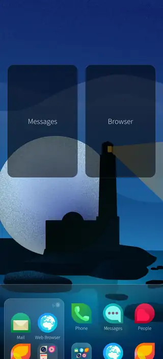

# Glass

The stock app grid draws a dark frost of whatever is behind it. Seaglass keeps one wallpaper instead: the home screen's
wallpaper stays where it is, and the app grid rises over it, sharp or frosted like glass. Folder icons, the open folder,
widget cards, the search and parts of the task switcher are glass too. All of them look through to the same wallpaper,
aligned with the home screen, the way Sailfish's own covers and menus do.

## What you see

The settings are in *Settings → Patchmanager → Seaglass → Glass*, under a live preview over your own wallpaper.
The *Look* sets the app grid's background:

- *Clear* (the default): only the icons rise. The wallpaper stays sharp under a dark veil, and open apps' covers fade
  out under the grid's rising edge.
- *Glass*: the wallpaper stays still while the glass rises with the icons. It frosts as it comes up, from clear at the
  first touch to fully frosted when open, and has a soft tint and a light line along its top edge.
- *Stock*: the Sailfish background, a blurred snapshot of what is behind.

The *Picture* can be another than the home wallpaper: the picture of another ambience, from the ones Sailfish OS
ships (`/usr/share/ambience`), or a photo from the Gallery. It is not on the home screen, so it cannot stay still under
the grid; it fades in as the grid rises. The ambience pictures let anyone try this without a photo of their own.

The motion moves the wallpaper seen through the glass, so every glass surface moves with it. With the grid closed, the
wallpaper is back in place. *Parallax* makes it follow the pages more slowly than the icons, by 6 % (subtle) or 12 %
(deep) of the screen's height a page, at most 18 % or 30 % in all. *Depth* shows it up to 10 % larger as the grid
rises. *Tilt* shifts it as the phone tilts, and *Drift* zooms it 8 % in and out, 14 seconds each way.

*Folder icons* turn a folder into a glass tile with a light rim, its small app icons on it and its own colour as a
soft glow. *Open folder* puts an open folder on a frosted sheet instead of the stock dark gradient; with the *zoom*
motion ([FOLDERS.md](FOLDERS.md)) the sheet grows out of the tile. *Widget cards* makes folders shown as widgets and
data widgets ([WIDGETS.md](WIDGETS.md)) glass, a touch lighter than the grid. Switched off, they take the background
of the app covers. Tiles are always frosted, and they stay glass with every look, *Stock* included. The search
([SEARCH.md](SEARCH.md)), the notification peek ([BADGES.md](BADGES.md)), the widget gallery and the switcher's chips
and recently closed apps ([SWITCHER.md](SWITCHER.md)) use the glass too, without a switch of their own.

The settings are in dconf under `/apps/seaglass/glass`, and the home screen follows them live:

| Setting | Key | Default | Values |
|---|---|---|---|
| Look | `look` | `clear` | `clear`, `glass`, `stock` |
| Picture | `picture`, `image` | `home` | `home`, or `photo` with its path in `image` (an ambience's or a photo) |
| Dimming (*Clear* only) | `dim` | 0.25 | 0 to 0.7 |
| Parallax | `parallax` | 1 | 0 off, 1 subtle, 2 deep |
| Depth | `depth` | true | |
| Tilt, Drift | `tilt`, `drift` | false | |
| Folder icons, Open folder, Widget cards | `folders`, `openFolder`, `cards` | true | |
| Frost | `frost` | 1 | 0 light, 1 medium, 2 strong |
| Tint | `tint` | `auto` | `auto`, `dark`, `light`, `none` |
| Edge light | `edge` | true | |

The `auto` tint is dark on a dark ambience and light on a light one.

## How it works

Sailfish draws app covers, menus and the dimmed home screen with `Background` from `Sailfish.Silica.Background`: a
quad that samples a texture through a material (a shader). The texture is placed by a frame item, `transformItem`, not
by the quad. So a quad that moves, clips or has rounded corners still shows the part of the picture that lies under
it. Each glass surface is such a quad, and all of them share one texture and one frame. The hook itself is described
in [ARCHITECTURE.md](ARCHITECTURE.md).

[GlassSource.qml](../qml/glass/GlassSource.qml) holds what they share. `HomeController.qml` makes it once and offers
it through `motion.js`.

- The picture is `Lipstick.compositor.wallpaper.homeWallpaperItem`, the texture the home screen itself draws. A photo
  is made square by `image://silica-square/`, as Silica's `ImageWallpaper` does, so it fits the same frame.
- The frost is a `FilteredImage` with Silica's `GlassBlur`. It needs `filtering: true`, or the picture passes through
  unblurred. It shrinks the picture to 128 to 256 pixels, blurs it and raises its saturation, once per picture or
  frost setting.
- The frame is our item inside the home screen's own, `Lipstick.compositor.wallpaper.transformItem`, a centred square
  that turns with the screen. The glass therefore lines up with the home screen in every orientation.
- The motion is the material's, not the frame's. `Background` does not follow its frame's geometry, nor a `Scale`'s
  origin or a `Translate` on it (only a `Scale`'s factor): moved that way, the parallax and the tilt stayed still on
  the phone while the numbers were right. So GlassSource gives the material the zoom, the anchor and the shift in the
  frame's coordinates (0 to 1 across it), and its vertex shader moves both textures' coordinates:
  `anchor + (coordinate - anchor - shift) / zoom`. The harness's `probe` scene checks that the picture follows.
- The material mixes the sharp picture with the frost by `frost`, fades from the home wallpaper to a photo by
  `reveal`, adds the tint and fades the top `edgeHeight` pixels in. It follows the stock `HomeMaterials.dimming`, which
  mixes the sharp and the blurred wallpaper while the Events view slides over the home screen. The faded edge needs
  `blending: true`; without it the edge only darkens.

`tintColor(level)` gives each kind of surface its tint. A tile on the grid gets a lighter one, because glass on
frosted glass stands out only with a lighter tint and a rim. GlassSource imports nothing from Lipstick, so the settings
page, another application, builds its preview from the same files, with the ambience's picture and a square frame of
its own.

[GlassPane.qml](../qml/glass/GlassPane.qml) is one surface: a `Background` on the source, with `frost`, a tint, a
`radius` and the edge light. It shows only while the source is `ready`. Until then, whatever uses it draws its stock
or plain look.

### The app grid

The hook adds a `Loader` to `layers/LauncherLayer.qml`, at `z: -1` in the layer's content item like the stock
`MenuBackground`, and passes the layer as `edgeLayer`. It loads
[LauncherWallpaper.qml](../qml/glass/LauncherWallpaper.qml), a full-screen GlassPane. `MenuBackground` hides while
ours `covers`: while the look is not *Stock* and the glass is ready.

The exposure is the layer's `absoluteExposure` over `maximumExposure`, eased. With *Glass* the frost and the tint
follow it. With *Clear* a black veil grows to `dim`, and the top `Theme.itemSizeLarge` pixels fade in, so that covers
dissolve under the edge instead of being cut. LauncherWallpaper sets the shared motion through `Binding`s:

- The zoom is 1 plus the larger of the depth (10 %) and the parallax's room, plus the tilt's room, times the exposure.
  Parallax needs a picture larger than the screen to travel in, and depth already makes it larger, so the two share
  one zoom. Its room is 6 % or 12 % of the screen's height for each page after the first (the pager's content
  height over its height), up to 18 % or 30 %.
- With parallax, the zoom's anchor runs down the screen as the pager goes from its first page to its last, which
  moves the picture by the zoom's extra size. Without it, the anchor is the screen's centre. Either way the tilt's
  room stays above and below it.
- Tilt shifts the picture by the `Accelerometer` (25 Hz, low-pass filtered), up to three times `Theme.paddingLarge`.
  Drift multiplies the zoom by up to 1.08.

The pager is the `SilicaListView` of `Launcher.qml` around the root grid, which `HomeController.qml` finds. The
launcher layer is made before the app grid, so LauncherWallpaper looks for the glass and the pager in `motion.js`
every half second for a minute.

### Folders, cards and the switcher

[FolderPreview.qml](../qml/folders/FolderPreview.qml) draws the glass tile under its small icons, with the folder's
stock shape decoded at 4 × 4 pixels and stretched as the glow. The stock shape is the picture of the folder's
`LauncherIcon`, and the preview is one of its children, so the icon cannot be hidden. The hook in `LauncherGrid.qml`
binds `launcherIcon.icon` to `""` instead, while `folderPreview.item.glass` is true. The stock `icon` is itself a
binding, and Qt 5's `Binding` restores bindings when it turns off, so the stock shape comes back by itself.

[FolderMotion.qml](../qml/folders/FolderMotion.qml) puts a GlassPane under the open folder's content. The hook reads
its `glass` as `seaglassGlass` and makes both stops of the stock gradient in `LauncherFolder.qml` transparent while it
is true. The sheet takes the folder's `radius`, which the zoom motion rounds like the icon while the folder is small.

`GroupWidget.qml` and `DataWidget.qml` draw a GlassPane instead of Lipstick's `CoverBackground.qml`, with no hook
change. The task switcher can be made before the app grid; until the shared glass turns up in `motion.js`, it makes a
GlassSource of its own.

## Costs

Each glass surface is one quad whose shader reads three textures: the sharp picture, the frost, and the home wallpaper
that a photo fades in over. Nothing is blurred per frame. With *Home wallpaper* nothing extra is decoded, because the
picture is the compositor's own texture. The motion is five uniforms of the material.

The material always blends (the *Clear* edge needs it), so the grid's full-screen pane is a blended quad. Each glass
folder icon keeps a small offscreen layer for its masked glow. The switcher's own GlassSource is a second frosted
wallpaper in memory, which is why it is dropped once the shared one is found.

The accelerometer runs only while the grid is out and the home screen is active (the launcher layer stays visible
under apps), and drift only while the grid is out. The stock home blur (`homeBlurSource` in `compositor.qml`) still
takes its snapshot whenever the launcher layer is exposed, although the glass covers it. Switching it off would mean
hooking the compositor, which Seaglass does not do.

## Limits

- With a photo chosen, every glass surface shows the photo once the grid is open.
- Until a photo has loaded, or when it cannot be loaded (deleted from the Gallery, for example), the glass is not
  ready, and every surface draws its stock look.
- The motion is shared. While the grid is pulled up, glass still visible on the home screen above it, such as the
  switcher's name chips, zooms with it.
- The glass comes from the app grid's controller. If `HomeController.qml` fails to load, the grid, folders and cards
  stay stock; only the switcher keeps glass of its own.

## The code

- [GlassSource.qml](../qml/glass/GlassSource.qml): the picture, frost, frame, material and settings.
- [GlassPane.qml](../qml/glass/GlassPane.qml): one glass surface.
- [LauncherWallpaper.qml](../qml/glass/LauncherWallpaper.qml): the app grid's background and its motion.
- [FolderPreview.qml](../qml/folders/FolderPreview.qml), [FolderMotion.qml](../qml/folders/FolderMotion.qml): the
  folder tile and the open folder's sheet.
- [GlassPage.qml](../qml/settings/GlassPage.qml), [GlassSettings.qml](../qml/settings/GlassSettings.qml): the settings
  page with its preview, and the dconf keys; [AmbiencePicturesPage.qml](../qml/settings/AmbiencePicturesPage.qml), the
  ambience pictures to choose from.
- [apply_hook.py](../hook/apply_hook.py): `hook_layer`, `hook_motion`, and the icon binding in `hook_layout`.
