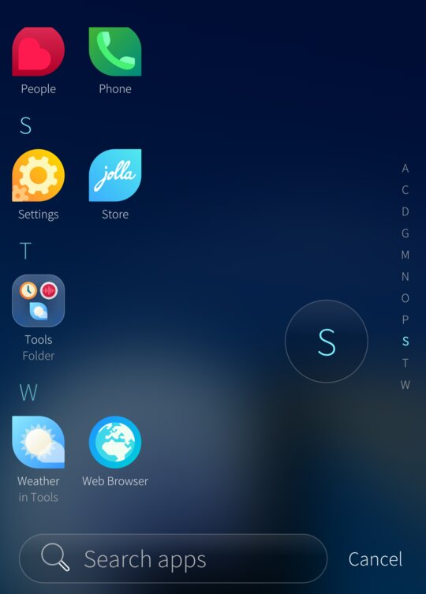

# Search

The stock app grid has no search, so finding one app among a hundred means turning pages. Seaglass adds a search
row to the first page of the app grid, with the apps you use most in it, and a glass sheet that finds any app or
folder from a few letters.

## What you see

The search row is a glass capsule across one row of the first page, like a dock: the magnifier and *Search* on the
left, the apps used most on the right, as many as fit (usually five). Without those apps it reads *Search apps*. The
other icons flow around it, so the first page holds one row of icons fewer.

Tapping the search grows a frosted sheet out of the capsule, with the keyboard up. Before you type, it shows the
apps used most, then every app and folder A to Z, with `#` last for names that do not start with a letter. An app in
a folder has its folder as a caption (*in Tools*). Dragging along the letter rail on the right edge shows the
letter in a bubble and jumps the list there. As you type, the matches replace the list, best first; the first has a
ring of light, and *Enter* launches it. A tap launches an app or opens a folder. A long press shows the item in the
app grid instead: the grid turns to its page and a ring of light pulses around it, or, for an app in a folder, the
folder opens. *Cancel* closes the sheet, and so does hiding the app grid or turning the display off.

The settings (*Settings → Patchmanager → Seaglass → Search*) are in dconf under `/apps/seaglass/search/`:

| Setting | Key | Values (default first) |
|---|---|---|
| Search row | `row` | `suggestions` (search and the apps used most), `pill` (search only), `off` |
| Position | `position` | `bottom` (the first page's last row), `top` (its first row) |
| Remember launches | `remember` | `true`, `false` |
| Forget used apps | `usage` | the launch counts, a JSON string; the button sets it to `{}` |

Bottom is the default: the app grid is pulled up from the bottom, so the thumb is already there, and while you type
the field rides on the keyboard with the matches just above it. At the top, the Jolla Phone's camera island crowds
the capsule. With *Remember launches* off, the counts already stored still rank the apps until you forget them.

## How it works

### The row

At the bottom, [HomeController.qml](../qml/core/HomeController.qml) draws the row in the app grid's content item,
over the first page's last row, which [grid.js](../qml/core/grid.js) keeps free (`reservedEnd`). No stock file
changes for it. At the top, the row takes a slot the stock grid already has: `LauncherGrid.qml` keeps its first row
free for the experimental launcher clock (`reserveFirstRow`) and draws the clock as the GridView's `header`. The
hook ([apply_hook.py](../hook/apply_hook.py)) makes `header` the controller's when it has one and hands it the
clock's component, and the controller's header stacks the clock, when it is on, above the row. Without our QML the
grid is stock ([ARCHITECTURE.md](ARCHITECTURE.md)).

### The sheet

[SearchSheet.qml](../qml/search/SearchSheet.qml) is made the first time the search opens, in the app grid's pager,
above an open folder. The home screen already takes typed text (an open folder's name is a `TextField`), so a Silica
`SearchField` works there. A half pulled up grid gets no keyboard, though, so the search first brings the grid fully
up, as opening a folder does, and the field asks for focus again when the opening motion ends. The field, the
capsule and the letter bubble use a denser tint of the [glass](GLASS.md) than the sheet, and the field's text is the
primary colour: highlight-coloured text on light glass could not be read over a bright wallpaper.

### Matching

The controller flattens the launcher's model into entries: the root items (apps and folders), and each folder's apps
with the folder's title. An entry also has its desktop file's name (`jolla-settings`).
[search.js](../qml/search/search.js) folds case and Latin accents (*meteo* finds *Météo*) and splits names into words
at spaces, punctuation, case changes and digits (*SkyPost* is *sky post*, *Chess960* is *chess 960*). Each word of
the query takes the first score that applies:

| Score | The query word is |
|---|---|
| 1000 | the whole name |
| 900 | the start of the name (shorter names first) |
| 800 | the start of a later word: *post* finds *SkyPost* |
| 700 | the start of the initials, from two letters: *ha* finds *Holiday Album* |
| 600 | anywhere in the name |
| 500 | the start of a word of the desktop file's name: *gallery* finds *Photos* |
| 400 | the start of a word of the folder's title: *too* finds the Tools folder, then its apps |
| up to 300 | four letters or more, in order from a word start, few skipped: *sttngs* finds *Settings* |

Every word must match (*home as*), and the entry gets the average. Use adds up to 60 points (12 × ln(1 + count)),
which mostly orders apps within a tier. The last rule is kept narrow: scattered letters from three letters on
brought up too many names.

### Launch counts

Launches from the root grid are counted on its stock `itemLaunched` signal, with the `currentIndex` the stock press
sets just before. [FolderMotion.qml](../qml/folders/FolderMotion.qml) watches the same signal on an open folder's
grid. The search, the row and the folder widgets launch through `LauncherActions.qml`, the stock way, and count
their own launches. A count is keyed by the desktop file path and halves every week. At most 120 apps are kept, and
an app launched once leaves the apps used most after about a month. The counts go to
`/apps/seaglass/search/usage` as one JSON string, 4 seconds after the last launch.

## Costs

- Each key press scores every entry. For about a hundred apps that is well under a millisecond.
- The A–Z list is plain `Repeater`s, not a view: every app has a tile, made again when the sheet opens or the grid
  changes. Closed, the sheet draws nothing.

## Limits

- Names in a non-Latin script match from their start or anywhere in them, but not by word starts or initials, and
  they sort under `#`.
- Launches from a notification, the task switcher or another app are not counted.
- Folders are known by their titles: of two folders with the same name, a long press on an app of the second opens
  the first.

## The code

- [search.js](../qml/search/search.js): matching, ranking, counts and A–Z sections, tested by
  [test_search.py](../tests/test_search.py) under Node.
- [SearchRow.qml](../qml/search/SearchRow.qml), [SearchSheet.qml](../qml/search/SearchSheet.qml),
  [SearchTile.qml](../qml/search/SearchTile.qml): the capsule, the sheet, an app or folder in it.
- [HomeController.qml](../qml/core/HomeController.qml): the entries, the counting, both rows, showing an item.
- [SearchPage.qml](../qml/settings/SearchPage.qml), [SearchSettings.qml](../qml/settings/SearchSettings.qml): the
  settings page and its keys.
