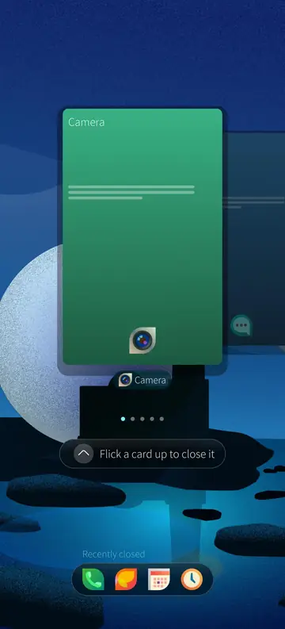

# Task switcher

The stock task switcher is a grid of live app covers on the home screen's wallpaper. A cover carries no name, so a
cover that shows only content (a web page, a photo) says little about its app. A busy wallpaper competes with the
covers. Once an app is closed it is gone from view, and starting it again means opening the app grid.

Seaglass puts a name chip under each cover, keeps the apps closed last in a *Recently closed* row, and can frost the
wallpaper behind the covers. It also adds a second layout, a row of cards swiped sideways, where a card pulled up
closes its app, and a pinch switches between the two. Closing otherwise stays the stock way: a long press for the
housekeeping mode, the × on a cover, the *Close all* pulley menu, and an app's own close gesture.

## What you see

The settings are under *Settings → Patchmanager → Seaglass → Task switcher*, in dconf
`/apps/seaglass/switcher`:

| Setting | Key | Default |
|---|---|---|
| *Background*: *Wallpaper* or *Frosted* | `background` | `wallpaper` |
| *Names under the covers* | `chips` | on |
| *Layout*: *Grid* or *Cards* | `layout` | `grid` |
| *Pinch between grid and cards* | `pinch` | on |
| *Flick up to close* (shown with *Cards*) | `flickClose` | on |
| *Recently closed*, and *How many* (1 to 10) | `recent`, `recentCount` | on, 5 |

Two more keys hold state: `recentApps`, the closed apps as a JSON list of desktop files, and `flickHints`, how often
the card row's hint has shown. *Forget closed apps* clears the first. *Reset settings* leaves both alone.

**Background.** *Wallpaper* is the stock look: your wallpaper as it is. With *Frosted*, the wallpaper frosts behind
the covers while apps run, with the app grid's frost and tint ([GLASS.md](GLASS.md)). With no app running it stays
sharp: the frost fades in with the first cover and out with the last. A pan to the Events view takes the frosted
pane along with the switcher.

**Name chips.** Under each cover sits a small glass chip with the app's icon and name, and the rows of covers move
apart to make room. A name wider than the cover fades out at the cover's edge, which happens mostly on the small
covers of a full switcher (three columns). In the housekeeping mode the chips fade out, because the stock × sits on
the cover's bottom edge.

**Recently closed.** A glass capsule of icons, the newest first, at the bottom of the screen: in the grid too, unless
the covers reach further down, and then after them. A tap starts the app again the stock way, and a long press takes it
off the row. The row lists the apps you closed (the ×, *Close all*, the app's own close) and the apps that quit, but not
a start that failed. An app leaves the row when it runs again. The row is kept across restarts of the home screen, and
it hides in the housekeeping mode.

**The card row.** The covers as a deck of cards, the most recently used app in front:
- The card in front is 56 % of the screen's width, in the cover's shape, with a soft shadow and its name chip. It sits
  in the middle of the room between the top of the screen and *Recently closed*. In landscape the height is the limit:
  a card is at most 62 % of the screen's height.
- The cards behind overlap it, smaller (83 %, then 75 %) and darkened by a veil. Two show on each side; further ones
  fade out. Every card is opaque: the stock cover background lies under each one, so a transparent cover does not let
  the wallpaper through.
- The next card is 62 % of a card's width away, about a third of the screen, so a short swipe turns one. A fling runs
  on over several cards and snaps one to the front. Dots under the row tell where you are.
- A tap on a card behind brings it to the front, and a tap on the front card opens its app. The cover's actions sit
  at the card's bottom. A long press starts the stock housekeeping mode, with a × on each card and *Close all* in the
  pulley menu.

**Flick up to close.** In the card row, the card in front can be pushed up to close its app, and each step shows what
will happen. The card follows the finger and shrinks a little, a dark veil falls over the wallpaper, and a glass ring
with a × comes out from under the card, above a *Pull up to close* pill. The ring fills as the card nears the point of
closing, about a third of the card's height up. Past that point the ring and the card turn the error colour, the pill
says *Release to close*, and a tick is felt. Let go there, or flick fast, and the card flies off: the app closes with
the stock close, its sound and vibration, the cards after it close up, and it joins *Recently closed*. Let go before
and the card springs back. Sideways swipes still turn the row; the finger's first move decides which it is. On the
first three visits to the card row, a glass hint under the dots says *Flick a card up to close it*, with an arrow that
nudges up. After the first card closed this way it does not show again.

**The pinch.** Pinch in on the card row and the cards rearrange into the grid. Pinch out on the grid and the covers
gather into the card row, with the cover under the fingers in front (between covers, the nearest one). The switch
follows the fingers: halving their distance goes the whole way to the grid, doubling it the whole way to the cards.
Let go past a third of the way, or after a quick pinch however short, and the switch finishes. Let go before and the
covers spring back. Nothing is felt at the point of no return. Pinching the other way has nowhere to go: the switcher
gives a few per cent around the fingers and springs back. The pinch sets *Layout*, so the switcher keeps the layout it
was pinched to, and the settings page shows it.

On the way to the grid, the card in front leads and each card further back starts a little later. The shadows and
veils go, the chips fade in under every cover, the dots and the hint fade out, and *Recently closed* glides to its
place in the grid. A grid that scrolls opens with the card that was in front in view. The way back runs the same
in reverse.

There is no pinch in the housekeeping mode, while a card is pushed up, or with no app running. A pinch never taps or
long-presses a cover: once the second finger lands, the cover under the first lets go, and a card half pushed up
springs back.

## How it works

The hook ([ARCHITECTURE.md](ARCHITECTURE.md)) changes two stock files. In `switcher/Switcher.qml`:
- A Loader next to `CloseAllAppsHint` loads [SwitcherController.qml](../qml/switcher/SwitcherController.qml). It hands
  the controller the stock pieces: `switcherRoot` (the switcher, a `SilicaFlickable`), `switcherGrid`,
  `switcherWrapper`, `switcherItems` (the covers' drawn layer), `repeater`, `switcherModel` and `mruSwitcherModel`.
- `switcherGrid.rowSpacing` grows by the controller's `chipSpace`, which the stock wrapper height and `ensureVisible()`
  already count.
- The wrapper's height grows by `extraHeight`, the room for *Recently closed* after the covers.
- In the card row, `contentHeight` is the switcher's own height, which holds off the stock vertical scrolling.
- A `PinchArea`, `seaglassPinch`, wraps `switcherWrapper` ("The pinch" below).

In `switcher/SwitcherItem.qml`, a Loader puts [SwitcherChip.qml](../qml/switcher/SwitcherChip.qml) under the cover.
It is a child of the cover's content item, so it moves, scales and fades with the cover when it closes, in
housekeeping and while it is dragged. The name and icon come from the cover's `launcherItem`. Without our QML every
changed value is the stock one, and the pinch area is off.

The app grid's change to `main/EditableGridDelegate.qml`, the stock base of `SwitcherItem`, runs here too. Its edge
scroll reads `manager.view.cellHeight`, and `SwitcherGrid` is a plain `Grid` with no `cellHeight`, so the hook falls
back to the item's height (`cellHeight || height`). Without that, a cover dragged down in housekeeping would not
scroll the switcher.

**Glass.** The chips, the capsule, the hint, the close ring and the frosted background (a `GlassPane` that fills the
switcher's view, under its content) are glass. The controller uses the app grid's `GlassSource` once `motion.js` has
it. A second blurred wallpaper costs memory, so the controller's own, in a Loader, lives only until then. `motion.js`
does not notify, and the switcher may be made before the app grid, so the controller looks once a second, for a minute
at most.

**Recently closed.** The stock `Repeater.onItemRemoved` fires while the removed cover still exists, so the controller
reads the cover's `launcherItem` there, without any change to the stock file. A pending cover (a start that failed) is
skipped. `onItemAdded` takes an app off the row when it runs again. The row keeps desktop file paths and makes a
`LauncherItem` for each, for its title and icon; an invalid one (an uninstalled app) is left out when the list is
read. A tap calls the stock `activateWindowFor()`, the call a tap on the app grid makes. In the grid the row is a child
of `switcherWrapper`, so it scrolls with the covers: at the bottom of the view, or after the covers when they reach
lower (the larger of the two).

### The card row

The stock covers stay. Hiding a stock `SwitcherItem` would hide the app's cover surface too: its `applyVisibility()`
sets the surface `Hidden` when the item is not visible. So only the drawn layer, `switcherItems`, is hidden, and the
card row draws each cover again: a `WindowPixmapItem` of the cover's window (or of the app's window when it has no
cover), in the order of `mruSwitcherModel`. Each cover is still drawn once.

Taps, long presses and cover actions go to the stock items: `clicked()`, the switcher's `housekeeping`, and a
`CoverActionModel` per card. Closing, by the × or by a flick, plays the stock `close_app` feedback and calls the stock
item's `close()`. The stock close animation runs on the hidden layer, and the model's removal takes the card out of
the row.

Apps draw their covers at the size the switcher asks for: `SwitcherItem` calls `requestSize()` on the cover surface
when `coverSize` changes. In the card row the controller sets `switcherGrid.coverSize` to the card's size, so the cards
are sharp. The stock sets `coverSize` itself whenever its columns change (in `doUpdateColumns()` and in the column
change animation), so the controller sets it again after each change.

The row is a horizontal `ListView` with a negative `spacing`, so its cards overlap. Each card's scale, veil, opacity
and stacking follow its distance from the middle, counted in cards. The stock `ensureVisible()` would scroll the
switcher under the status bar, so in the card row the controller holds `contentY` at 0, except in housekeeping, where
the *Close all* pulley menu needs it. The row's place does not depend on the layout: room for the dots and the hint is
kept under it in both, so a switch to the cards lands where the row is.

Each card has a `MouseArea` that drags it up only (`drag.axis: Drag.YAxis`, `drag.maximumY: 0`). The `ListView` takes
sideways moves and the card takes upward ones. Once the card's drag is active it keeps the touch (`preventStealing`),
and the row stops scrolling. A release past 32 % of the card's height, or faster than 1.4 px/ms upwards, flies the
card off; anything less springs it back. The tick is the stock `push_gesture` feedback. Both feedback objects are made
with `Qt.createQmlObject`, as the stock switcher makes its own, so there is no hard dependency on `Nemo.Ngf`.

### The pinch

Qt Quick gives two touch points to one item only if that item filters its children's touches, as a `PinchArea` does
for the items inside it. A `PinchArea` laid over the switcher would take every single tap as well. So the pinch area
has to be an ancestor of the covers and the cards: the hook wraps `switcherWrapper` in `seaglassPinch`, as large as the
switcher's content, and the card row lives in it too (so in housekeeping the *Close all* pull-down moves the card row
down, as it moves the grid). `PinchArea.enabled` is the area's own property: unlike `Item.enabled`, turning it off
leaves the covers inside enabled. The controller turns it on only while there are covers and no housekeeping. Once both
fingers are down, the area grabs them and keeps the grab, so neither Lipstick's pan to the Events view nor the
switcher's own scrolling takes over.

[SwitcherPinch.qml](../qml/switcher/SwitcherPinch.qml) turns the pinch's scale into progress: 0 where the pinch
started, 1 at the other layout. It counts in doublings of the fingers' distance (a log scale), so that pinching in and
out feel alike. On release the switch goes on if it is past a third and not moving back fast, or if it is moving
forward quickly, even short of a third. Fingers held still for 120 ms before letting go count as slow. The progress
then runs on to 1 or back to 0, quicker the less is left (0.4 s at most). The other way gives through a `Scale` on the
pinch area, around the fingers, of 4 % at most.

[SwitcherMorph.qml](../qml/switcher/SwitcherMorph.qml) is a layer over the switcher while a switch runs. It holds one
live cover per app (a `WindowPixmapItem`, as in the card row), which flies on a straight line from its place in one
layout to its place in the other. The stock covers and the card row are hidden meanwhile, so each cover is still drawn
once. A card's place comes from the row's pitch, card size and scroll, with the scale, veil and fade the row gives it.
A grid place comes from `SwitcherGrid`'s columns, cover size, spacing, row spacing (with the chips' room), top and
centring. Towards the cards it is read from the stock cover; towards the grid it is computed, because in the card row
the stock grid holds its covers at the card's size. On the way, the card's opaque backing fades, and the ambience
background stays only where the stock draws it: under a transparent cover, or one that is still
starting.

**Stills hide the redraws.** Apps draw their covers at the size asked, with their own fonts and spacing, so a cover
drawn again at another size is laid out anew, not scaled. If the apps were asked only once the switch is over, every
cover's look would jump at the end. So at the first move the controller asks each cover surface for the other layout's
size directly (`requestSize()`, the stock grid's `coverSize` untouched), after taking a still of every cover
([CoverFade.qml](../qml/switcher/CoverFade.qml), a `ShaderEffectSource` with `live: false`). The still lies over the
live cover until the app has drawn it again (its `windowSize` changes), or for 0.7 s at most, then fades out over
240 ms. The live cover stays opaque under it: a cross-fade of two half-faded layers would let the wallpaper through.
The layer is drawn, unseen, from the pinch's start, so that every flying cover has its picture by the first move. The
stills are taken a frame after that move, and a cover with no picture yet gets none, as its still would hold an empty
cover. If the switch springs back, the old size is asked back the same way.

**Finishing.** The controller writes `layout`, and the stock `coverSize` changes to the size the apps already draw
at. The stock grid then lays its covers out again for that size with its own moves: a cover that changes columns
slides, and one that changes rows fades out and back in, 150 ms each. When an app's cover comes back, the stock also
fades its picture in over 500 ms. Uncovered while these run, the grid flashes. So the layer holds its last frame until
the layout under it is ready: the stills have faded, and every stock cover is at rest at its place (not moving, not
fading, its picture not fading in), or the card row is still with the chosen card in the middle. It holds for 80 ms at
least and 1.2 s at most. With *Debug log* on, the journal says how long it held
(`seaglass: pinch to grid shown after 160 ms`), how far its last frame was from the layout shown
(`pinch to grid fit 0 px`), and which covers, if any, still move or fade in the 0.4 s after.

## Costs

- A chip is a small glass quad, an icon and a label per cover. The frosted background is one quad sampling the
  shared frost. Until the app grid's glass is found, the switcher keeps a second blurred wallpaper.
- The card row costs about what the grid does, as the stock layer is hidden while the row draws. The apps draw their
  covers at the card's size, which is larger than the grid's.
- *Recently closed* is a few icons, a `LauncherItem` per remembered app, and a dconf write when the row changes.
- The pinch costs nothing at rest: with one finger the pinch area lets the touches through. A switch draws a live
  cover, a still and a chip per app, for as long as the fingers move, plus up to 0.4 s of settling and 1.2 s of
  holding.

## Limits

- Rearranging covers by dragging works only in the grid. Flick up to close works only in the card row, and only on
  the card in front.
- The grid's places in a switch are computed from `SwitcherGrid`'s numbers. If a Sailfish OS update changes the
  stock layout, the covers jump at the end of a switch to the grid; the `fit` line of the Debug log shows by how much.
- An app that does not draw its cover again at the new size shows its old picture, scaled, once the still has faded.
- *Recently closed* lists only apps with a desktop file. An uninstalled app stays on the row until the list is read
  again, at the latest when the home screen restarts.

## The code

- [SwitcherController.qml](../qml/switcher/SwitcherController.qml): the hook's entry point. The settings, the glass
  and the background, the recently closed apps, the card row with its dots, veil and hint, and the pinch's start,
  places and finish.
- [SwitcherCard.qml](../qml/switcher/SwitcherCard.qml): a card, with its chip and flick up to close.
- [SwitcherChip.qml](../qml/switcher/SwitcherChip.qml): the name chip, under a stock cover or a card.
- [SwitcherHint.qml](../qml/switcher/SwitcherHint.qml): the card row's hint.
- [RecentApps.qml](../qml/switcher/RecentApps.qml): the *Recently closed* capsule.
- [SwitcherPinch.qml](../qml/switcher/SwitcherPinch.qml): the gesture: progress, the point of no return, speed.
- [SwitcherMorph.qml](../qml/switcher/SwitcherMorph.qml): the layer that flies the covers between the layouts.
- [CoverFade.qml](../qml/switcher/CoverFade.qml): a still over a cover while its app draws it again.
- [SwitcherPage.qml](../qml/settings/SwitcherPage.qml) and [SwitcherSettings.qml](../qml/settings/SwitcherSettings.qml):
  the settings page, and the keys with their defaults.
- [apply_hook.py](../hook/apply_hook.py): `hook_switcher()` and `hook_switcher_item()`.
- [SwitcherScene.qml](../harness/SwitcherScene.qml): the harness scene `switcher mode=grid|cards|pinch`
  ([DEVELOPMENT.md](DEVELOPMENT.md)). The harness has no live app windows, so it runs on made-up covers; live covers
  and Lipstick's own layers can only be tried in the home screen.
