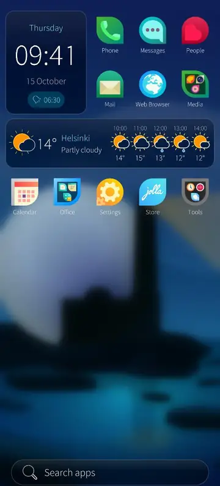

# Data widgets

Data widgets put live information on the app grid: the time, the battery and the connections, the music that is
playing, the next events and the weather. Each one is a glass block among the icons. Unlike a folder shown as a card
([FOLDERS.md](FOLDERS.md)), it has no folder behind it.

<p align="center"></p>

## What you see

### Adding a widget

In the launcher's edit mode, a glass capsule *Add widget* sits at the bottom of the screen. On the first page it
takes the place of the search row, when that is at the bottom ([SEARCH.md](SEARCH.md)). On the other pages it lies
over the last row's names, which the stock hides in the edit mode. It fades out while anything is dragged.

A tap raises the widget gallery: a glass sheet with a section per kind, each with live, scaled-down previews of its
sizes. A tap on a preview closes the sheet and adds the widget at the top of the current page, where a ring of light
pulses around it. A long press lifts the widget out at full size while the sheet slides away, and the finger carries
it to its place: an outlined slot shows where it will land, the icons make room, and the page turns at the screen's
edge. A kind whose module is missing on the phone (no Weather app, say) is dimmed, with a line about what it needs.
The sheet closes with a tap above it, or when its handle or its content is pulled down; the app grid stays. A kind can
be added more than once.

### Moving, sizing and removing

Data widgets have the sizes of group widgets. A *card* is two by two cells, a *shelf* is the full width and one row,
and a *panel* is the full width and two rows. The clock has no panel.

In the edit mode a widget is outlined, its content dims and its buttons rest. A glass pill at its bottom has the
sizes of its kind, drawn as sketches of their blocks, and an ×. A tap on a size resizes the widget in place, and the
× removes it at once. To move a widget, drag it. In the edit mode a press lifts it after 150 ms, as the stock lifts
an icon. Outside the edit mode, a long press anywhere on the widget starts the edit mode and lifts it. The icons
slide out of its way, and the page turns at the screen's top or bottom edge. Icons can be dropped right before or
right after a data widget, but never into one.

With *Glass → Widget cards* on ([GLASS.md](GLASS.md)), a data widget takes the darker tint of the glass's text
controls, not the lighter tint of a group widget's tile, because it carries text. Without it, the widget uses
Lipstick's cover material with a veil over it. Every colour comes from the ambience, so a light ambience works too.

### The five kinds

A tap on a widget opens its app or settings page. Its buttons, chips and events act in place.

**Clock** (card, shelf). Digital, with the weekday, the time in Sailfish's heading font and the date, or analogue: a
dial without a second hand, because the clock changes once a minute. A chip shows the next enabled alarm (not a
countdown timer), with its weekday when it is more than a day away. The 12 or 24 hour clock follows the phone.

**Status** (card, shelf, panel). The battery is a ring that fills with the charge, in the error colour below 15 %,
with a bolt while charging or the battery-saver icon in power saving mode. Wi-Fi, mobile data, Bluetooth and flight
mode are chips, lit when on and ringed when connected. The shelf adds their names, with the Wi-Fi network's once
connected. The panel gives each a line of its state, such as the network's name or the connected Bluetooth device's.
A tap on a chip switches it, as the top menu's switches do. Mobile data only opens its settings page, because
switching it needs the SIM's data context. So does a switch that the device policy forbids, and Wi-Fi while
tethering. A tap beside the chips opens the battery settings.

**Now playing** (card, shelf, panel). The album art with the player's icon on its corner, the title and the artist,
a progress line, and previous, play/pause and next. The panel adds the album and the times, and with several players
a chip that switches between them. The art, blurred and dimmed, can fill the glass. A tap on the art or the title
brings the player up. With no player, or after 30 minutes paused (as on the lock screen), the widget says *Nothing
playing*. Its play button resumes a paused player, or starts the last one again, or the Media player before any
player has run.

**Next event** (card, shelf, panel). The weekday and a large day number, and the coming events with their calendars'
colours. A time reads "14:00–15:00", "All day", "in 25 min" within the hour, or "Now – 15:00". Cancelled events are
struck through. The card has the next event in two lines and the one after it in one, with "+2 today" when more
follow. The panel lists up to five under *Today*, *Tomorrow* and weekday headings. When nothing is left today, the
widget says *No more events today* above the next one. A tap on an event opens it in the Calendar, as the Events view
does; anywhere else, the Calendar opens on today.

**Weather** (card, shelf, panel). The card has the place, an icon with the temperature, the description, "Feels
like", and today's high and low. The shelf and the panel put the weather now beside or above five columns: the next
hours on a shelf, the next days on a panel, unless the setting picks one for both. The panel also has the provider's
logo, as the Events view's banner does. Without a place set up in the Weather app, the widget says *Set up Weather*.
Offline, the last weather stays, marked "Updated 5 h ago" from three hours on.

### A fresh install

The first time the home screen runs Seaglass with a widget list that has never been written, it places two starter
widgets: a clock card at the start of the grid, and a status shelf after the first six apps, which on the Jolla
Phone's five columns is the row under the clock. A list the user emptied stays empty. Then, while the app grid is
out, a hint says "Hold a widget or an icon to edit the grid. Add widget is at the bottom then." It is the stock
`InteractionHintLabel` that the tutorials use. It goes away for good once the edit mode starts or the hint is tapped.

### Settings

*Settings → Patchmanager → Seaglass → Widgets*. Changes apply at once. The keys are in dconf under
`/apps/seaglass/widgets/`:

| Setting | Key | Values (default first) |
|---|---|---|
| Show widgets | `show` | `true`, `false` (the widgets are hidden, and the list is kept) |
| Clock face | `clockFace` | `digital`, `analogue` |
| Next alarm on the clock | `clockAlarm` | `true`, `false` |
| Switch from the status widget | `statusSwitches` | `true`, `false` (the chips open their settings pages) |
| Now playing when idle | `playerIdle` | `last` (play the last player), `hide` (no play button) |
| Album art behind | `playerArt` | `true`, `false` |
| Events: days ahead | `eventDays` | `6`, `3`, `0` (today only) |
| All-day events | `eventAllDay` | `true`, `false` |
| Hide event details | `eventPrivate` | `false`, `true` (the times and colours, with *Busy* for each title) |
| Weather forecast | `weatherForecast` | `auto` (by size), `hourly`, `daily` |
| Weather: Feels like | `weatherFeels` | `true`, `false` |

*Restore starter widgets* adds the clock card and the status shelf at their starter places, each unless a widget of
its kind is already there. *Remove all widgets* empties the list, after a remorse timer. *Reset settings*, in the
pulley menu of the settings' first page, resets the options and keeps the widgets. A backup, made in the *About*
page, includes the list.

## How it works

### Where a widget sits

Lipstick keeps the app grid's order in `~/.config/lipstick/applications.menu`, and a group widget's place is its
folder's place there. A data widget has no folder, so it holds a *slot*: its index in the grid's order with the data
widgets spliced in. In `[Phone, Messages, Clock card, Camera, …]` the clock's slot is 2.
[grid.js](../qml/core/grid.js) lays out this combined order as it lays out the icons: each item at the first free
place where its block fits, so icons after a card fill the cells beside it.

Model changes leave the slots alone: a new app (added at the end) or a removed app leaves the widget where it is, and
the icons flow around it. When an app before a widget is removed, the first icon after the widget comes before it. A
slot past the end puts the widget at the end. When a drag or an add writes the slots, they become the widgets' actual
positions in the new order. Slots count items, not cells, so in landscape the same order fills a wider grid.

The stock drag of an icon speaks in model indexes, and "before Camera" cannot tell whether the icon goes before or
after the clock card. So the controller decides from what the drag aims at. The stock delegate asks `itemAt()`,
which the hook hands to [HomeController.qml](../qml/core/HomeController.qml). Over an icon the answer is that icon,
and after the stock move (`rowsMoved`) the controller puts the moved icon right next to it, on the side the stock
chose. Over a data widget the answer is a stand-in: its left half means right before the widget, its right half
right after it.

A dragged data widget aims as a group widget does: the controller tries every place in the order and takes the one
whose layout puts the widget nearest to the cell under its top left corner. The layout follows the aim live, and the
slots are written on release. A group widget's drag aims over the combined order too, so the data widgets keep their
places around it. A widget carried out of the gallery is laid out as `new` and aims the same way. A tap in the
gallery gives the widget the slot that lays it out nearest to the current page's first row.

### What is stored

The widgets are one dconf key, `/apps/seaglass/widgets/list`, a JSON list:

```json
[{"id": "w1", "kind": "clock", "size": "card", "at": 0}, {"id": "w2", "kind": "status", "size": "shelf", "at": 7}]
```

An id is `w` and a number, one above the highest in the list. The key's default is the empty string, which means
"never written" and brings the starter widgets; an emptied list is `[]`. Entries of a kind this version does not
know are kept but not shown, so that an older version never drops a newer one's widgets. Two more keys belong to the
widgets: `/apps/seaglass/widgets/lastPlayer`, the desktop entry name of the last MPRIS player, for the idle
play button, and `/apps/seaglass/editHint`, the hint's state (`pending`, then `done`).

Nothing in `applications.menu` refers to a data widget. Without our QML (the patch off, or the package removed), the
grid is the stock grid with nothing left over. When the QML is back, so are the widgets.

### Data sources

Each kind has one source, shared by all its widgets, in a file of its own.
[DataSources.qml](../qml/widgets/data/DataSources.qml) loads it with a `Loader` only while a widget of its kind is on
the grid or the gallery is open. A module that is missing or fails to load makes only its kind unavailable, and its
widgets say *Not available on this phone*. Every source reads what a stock part of the home screen already reads,
the way that part reads it:
- Clock: `Nemo.Time` `WallClock`, once a minute; `Nemo.Alarms` `AlarmsModel` through `EnabledAlarmsProxyModel`,
  read with an `Instantiator` because the model has no `count`; the stock clock's 12/24 hour key,
  `/sailfish/i18n/lc_timeformat24h`.
- Status: `BatteryStatus`, `McePowerSaveMode`, Connman's `NetworkTechnology` and `NetworkManager` as the status bar
  uses them, `BluetoothStatus`, and `AccessPolicy` for the switches. A switch sets `powered` or `offlineMode` on the
  same Connman objects, after the policy check that the top menu's switches make.
- Now playing: `Amber.Mpris` `MprisController`, as the lock screen's controls, and the player's icon from its
  desktop entry.
- Next event: `org.nemomobile.calendar.lightweight` `CalendarEventsModel`, set up as the Events view's (past events
  left out, at most six), and `com.jolla.calendar.ui` over D-Bus to open an event or a day.
- Weather: `Sailfish.Weather`, as the Events view's weather banner uses it: `SavedWeathersModel` (the Weather app's
  current place), `WeatherModel`, an hourly and a daily `WeatherForecastModel`, and `TemperatureConverter`.

Now playing never uses `Sailfish.Media`'s `MprisPlayerControls`: its `MprisManagerControls` also takes the headset
buttons, and a second copy in the home screen would toggle play twice on one press. MPRIS does not signal the
position as it moves, and reading it is a D-Bus call to the player. So the source reads it only when the track, the
player or the playing state changes, on `Seeked` and when the grid comes up, and reckons it from there.

The calendar model covers today and up to six days ahead, so that no weekday name comes twice. It moves on at
midnight and when its answer expires (the stock rule), not each time the grid shows.

The weather models are active only while the grid is shown, and the stock models request the weather now and the
hours at most every 30 minutes, the days every 3 hours. Requests go through the stock provider and its cache, which
the Events view shares in the same process. The Weather app and the Events view write the same saved file, and
`SavedWeathersModel` follows it. What the widget fetched is saved when the grid goes away, only after a fetch, as the
banner does.

### Privacy and sample data

What the widgets carry shows on the app grid: song titles, event titles and places, the weather's place, the Wi-Fi
network's name and a Bluetooth device's name. Anyone who sees the app grid sees them, as with the Events view.
*Hide event details* covers the calendar.

The development harness ([DEVELOPMENT.md](DEVELOPMENT.md)) must never read the phone's own data, so it runs the
sources in demo mode, with made-up tracks, events and places. The weather and calendar models are not even made: no
saved place is read, no request is sent and no event is queried. A source learns that it is in demo mode only after
its `Loader` made it, so these two wait one event-loop turn before making their models. In demo mode nothing is
written. The `widgets` scene's sample states and setting words are listed in
[WidgetsScene.qml](../harness/WidgetsScene.qml).

### How it plugs in

Data widgets use only what the hook already gives the group widgets ([ARCHITECTURE.md](ARCHITECTURE.md)). The
controller keeps their blocks beside the delegates' (`layout.extra`, by id), and puts the widgets in the grid's
content at their blocks, with the hook's `targetX` and `targetY` formula. The footer counts the layout's rows, so
the pages that widgets add are made.

A widget's touches go to one `MouseArea` over its face, so that a long press lifts it wherever it lands, and the face
finds the control under a tap itself ([faces.js](../qml/widgets/data/faces.js)). The drag follows the stock
delegate's: the body moves to `gridManager.dragContainer` (the pager), so that it stays under the finger while pages
turn. A lifted widget sets `preventStealing`, so that the pager cannot take the touch. With it set, a `MouseArea`'s
own `drag.target` never starts, so the body is moved by hand. The controller never sets the stock `reorderItem`, so
no stock code takes the widget for a delegate.

The app grid closes when it is dragged down: the compositor's `launcherInteractiveArea` takes the drags of everything
on the launcher layer. While the gallery is open that area is off, and so is the pager, so a pull down on the sheet
closes the sheet only. Both come back when it closes, as their `enabled` and `interactive` are bindings.

## Costs

- With the app grid hidden or the display off, nothing ticks and the weather asks for nothing. The other stock
  objects stay connected and get their change signals, as the status bar's do.
- With the grid shown, the clock, event and weather sources each wake once a minute. While a track plays, a
  one-second tick moves the progress; the position is read over D-Bus only when something changes.
- Only the weather uses the network, under the stock rules above.
- There is one source per kind, however many widgets. Opening the gallery loads all five for the previews.
- Aiming a drag lays out the grid once per place in the order, only when the aimed cell changes.

## Limits

- The sources rest per grid, not per page: a widget on a page that is not shown keeps ticking while the grid is.
- A widget keeps its neighbours, not its cell. A backup restored on a phone with another app order puts the widgets
  at the same slots, next to other apps, because the app order is Lipstick's and the backup leaves it out.
- Now playing follows one player at a time, and only the panel switches players.
- Weather shows only the Weather app's current place.
- The modules belong to other packages: the Weather app, the Calendar and the media support. When one changes, its
  kind becomes unavailable, and the rest of the grid stays as it is.

## The code

- [DataWidgets.qml](../qml/widgets/data/DataWidgets.qml): the list in dconf, add, remove, resize, the slots, the
  starter widgets.
- [DataWidget.qml](../qml/widgets/data/DataWidget.qml): a widget on the grid: the glass, its face, the size pill,
  the touches and the drag.
- [DataSources.qml](../qml/widgets/data/DataSources.qml): the sources, loaded on demand, with `live` and `demo`.
- [AddWidget.qml](../qml/widgets/data/AddWidget.qml), [WidgetGallery.qml](../qml/widgets/data/WidgetGallery.qml):
  the capsule, and the gallery with the widget carried out of it.
- `clock/`, `status/`, `player/`, `event/`, `weather/`: per kind, a `*Source.qml` that reads the data, a `*Face.qml`
  that draws it in every size, and the face's parts.
- [grid.js](../qml/core/grid.js): the combined order, tested by [test_grid.py](../tests/test_grid.py).
- [HomeController.qml](../qml/core/HomeController.qml): the layout with data widgets, `itemAt` over them, the drag
  aims, the gallery, the starter widgets and the hint, and opening what the faces ask for.
- [SizeBar.qml](../qml/widgets/SizeBar.qml): the size pill, shared with the group widgets.
- [WidgetsPage.qml](../qml/settings/WidgetsPage.qml), [WidgetSettings.qml](../qml/settings/WidgetSettings.qml): the
  settings page, and the keys with their defaults.
